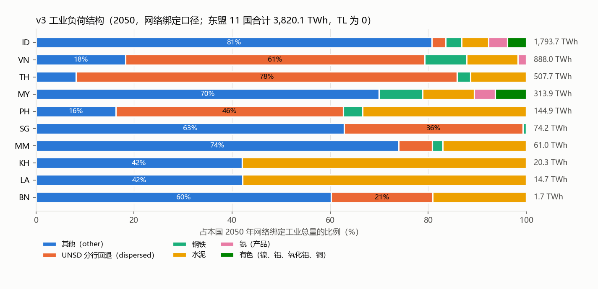
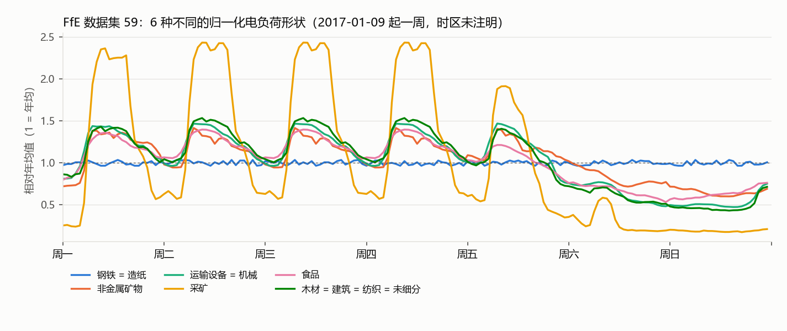

# v4 工业细分 S0：数据登记与口径摘清（台账 W03，决策 196、198）

- **指令：** `V4_S0_INSTRUCTION.md` v1，SHA256 `9d142beeca6b458e53b967df20ab909210ed69dc93f7b274a6585aec28c1de13`，与 `V4_S0_SHA256.txt` 一致；开始条件由用户 2026-11-05 确认（08 FfE 不补，`opendata.customization` 即数据集 59 的完整 JSON）。
- **分支：** `codex/v4-data-20261105`，worktree `/home/jin/wt_v4_data`，起点 `1117a07f`（`codex/v3-fix-20261105` 头，本地与远端一致）。交付目录 `research/06_scope_redesign/p1_v4_data_20261105/`，与 `work/p1_v4_data_20261105/` 同步（不含 `downloads/`、`extracted/`）。
- **性质：** 只读摸底与设计。没有改模型代码、配置、网络、注册表；求解器 0 次；没有下载新数据。
- **证据等级：** VERIFIED（实际读到的表、数组或回执）、EXACT（逐项可复现的精确核对）、INFERENCE（机制解释或推断）、PROPOSED（设计，未执行）。数据等级：A 实际产量或统计；B 官方产能或带路线的全国统计；C 推导、代理、欧盟或区域系数；D 模型估计；E 缺失。
- 报告中的数字都来自 `V4_S0_EVIDENCE.json` 与 `evidence/` 下的表，由 `scripts/` 中的脚本生成，没有手算。

## 0. 结论摘要

1. **数据登记（VERIFIED）：** `downloads/` 37 个文件 1,022,263,964 B，逐个登记 SHA256、来源、版本、许可（`DATA_REGISTRY_V4_DOWNLOADS.csv`）；压缩包解到 `extracted/`（399 个成员，1.34 GB）。隐私扫描没有发现用户个人信息。缺口 9 项（第 1.3 节），没有一项挡住 S0。
2. **"其他"桶精确数（EXACT）：** v3 网络绑定口径下，东盟 11 国"其他"桶 2050 年 **2,003.85 TWh，占绑定工业总量 3,820.05 TWh 的 52.46 %**（v2 为 2,593.19 TWh、67.88 %）。2019 投入能源口径：v3 等效 959.38 TWh，占 2019 工业 1,905.19 TWh 的 50.36 %（v2 为 1,173.37 TWh、61.59 %）。ID 一国占 1,449.04 TWh（东盟其他桶的 72 %），其次 MY 219.67、VN 162.51 TWh。
3. **结构（VERIFIED）：** 其他桶 2050 年 75.6 % 是有用热（1,514.04 TWh，其中 >400 °C 744.97、200–400 °C 513.16），19.1 % 是电（383.38），5.3 % 是柴油机用油（106.43）。节点分配：ID、MY、PH 用 DOSE 2019，TH、VN 用 DOSE 2018，其余国家用 v2 用电份额。**全部工业负荷全年恒定**：F1 网络 871 个工业负荷没有一个带时间序列，网络负荷与 v3 表逐国逐载体相差不超过 1.3e-12 TWh。
4. **真正自下而上的部分只有 19 %（EXACT）：** 2050 年钢 183.63、水泥 360.77、氨 98.14、有色 88.62 TWh 是按产量算的；`dispersed`（UNSD 或 APEC 分行 × EU27 权重回退）1,085.05 TWh 与"其他" 2,003.85 TWh 合计占 80.9 %。
5. **建筑与采矿（EXACT）：** 只有 MM、PH、TH、VN 的 UNSD 有这两行；2050 年建筑 39.87、采矿 43.54 TWh，都在"其他"桶里，设施数据覆盖不到，会一直留在余量中。
6. **口径（VERIFIED + INFERENCE）：** `T_v2` 只含能源用途。非能源用途按 AEO8 附录 E 在 TFEC 之外（DFX F1.2 已移出），氨的原料气已从 NEU 扣除（DFX F2.4）。UNSD 工业行只取"consumption by <行业>"，焦炉转换、高炉转换、煤矿与炼厂自用都不在内；钢铁业消费的焦炭在钢铁行内。炼油不在工业终端。
7. **边界陷阱（VERIFIED 数值，INFERENCE 解释）：** ETSAP 的 BF-BOF BAT 为 5.42 MWh/t（全流程含高炉还原剂），JRC-IDEES/PyPSA-Eur 现状"Integrated steelworks"只有 2.29 MWh/t（终端消费口径）。按 ID 2024 年粗钢 18.64 Mt 估算，两种口径分别是 83.9 与 35.1 TWh，而 UNSD 2019 钢铁行是 37.8 TWh。S1 必须先对齐口径再比较。
8. **数据源要点（VERIFIED）：** GEM 钢铁逐厂产量很少（东盟 56 家运营厂中，每年只有 5–9 家有粗钢产量）；GEM 水泥 ID 46 家运营厂只有 15 家有熟料产能；SFI 造纸 227 家里只有 16 家有纸浆产能、燃料字段全空；**Climate TRACE 东盟 2025 年各制造业子行业的活动量严格等于"产能 × 利用率"**，是模型估计，不能当年产量；石灰、其他化工、其他制造、其他金属在东盟没有资产级来源。ETSAP 中东盟 11 国全部属于 ODA；ODA 的有色燃料低效系数 6.77、化工用电系数 4.90 吸收了产品清单外的能耗（INFERENCE），不能按产品套用。
9. **预计降幅（PROPOSED，量级）：** 用造纸、玻璃/石灰、化工设施数据，并按"先扣同名 UNSD 分行、再扣其他"的规则，东盟其他桶约可减少 202–211 TWh（约 10 %），其中 ID 141 TWh（造纸）、MY 55 TWh。ID 其余约 1,300 TWh 靠设施数据解释不了，要靠国家统计核对（师哥第 5 条的"区域余量"）。另有两个 S1 必查项：BN 的化工设施能耗是其整个其他桶的 10 倍；ID 2019 其他桶中 269 TWh 煤可能含镍冶炼园区自备电厂用煤。
10. **曲线（VERIFIED）：** FfE 11 条曲线只有 6 种不同形状，**化工、有色没有曲线**，文件里没有时间戳也没写时区；NREL 是按"月 × 星期 × 小时"给的典型周，形状很平（峰均比中位 1.03–1.09）。Calliope-Indonesia 有 34 个省、2050 年需求（RUPTL 情景 1,141 TWh）与潜力，**仓库没有许可证**，引用前要问师哥。

## 1. 数据登记

### 1.1 登记表

全表见 `DATA_REGISTRY_V4_DOWNLOADS.csv`（列：相对路径、字节、SHA256、来源、网址、版本或发布日期、许可、许可依据、内容、解压位置、备注）。SHA256 与另一次独立的 `sha256sum` 逐个一致。

| 子目录 | 文件数 | 字节 | 版本 | 许可（依据） |
|---|---:|---:|---|---|
| 01 GEM 钢铁 | 1 zip（5 个 xlsx） | 61,602,981 | 厂级、炼钢、炼铁 2026-09 V1；Ownership 2026-10；冶金煤与铁矿 2025-12 | CC BY 4.0（About 页） |
| 02 GEM 水泥 | 1 zip（2 个 xlsx） | 61,411,816 | 2026-07 V1 Standard Copy | CC BY 4.0（About 页） |
| 03 GEM 化工 | 1 xlsx | 478,664 | Global Chemicals Tracker 2026-11 V1（状态截至 2026-09-30） | CC BY 4.0（About 页） |
| 04 SFI 造纸 | 1 xlsx | 1,064,273 | 2025-07 | CC BY 4.0（About_General 页） |
| 05 SFI 乙烯 | 1 xlsx | 237,368 | 2025-12 | CC BY 4.0（清单所记 Zenodo 页；文件内无说明） |
| 06 Climate TRACE | 24 zip | 859,577,416 | 22 个行业分包 V5.12.0（2026-10-29 生成）；2 个汇总包 V5.5.0（2026-03-22） | CC BY 4.0，有例外（见下） |
| 07 ETSAP | 1 zip | 672,921 | v2.1.0（提交 678c2b4），数据基年 2018（玻璃 2020） | CC BY 4.0（README、LICENSE），附 Statista 转载限制 |
| 08 FfE | 2 | 1,324,178 | 数据集 59，参考年 2017 | CC BY 4.0（元数据，© FfE, eXtremOS Project） |
| 09 NREL | 4 | 24,031,322 | 2019-09-27（tar 目录名）；gzip 头 2020-02-21 | 未知（文件内无说明） |
| 11 Calliope-Indonesia | 1 zip | 11,863,025 | 提交 c8584f7b（2024-04-01） | 未知（仓库无 LICENSE） |

说明（VERIFIED）：

- 两个 GEM 压缩包的 SHA256 与 v3 摄入时的 `02_facilities/gem-download.zip`、`gem-download (1).zip` 相同，是同一份下载；两个包里的 Ownership Tracker 逐字节相同。
- Climate TRACE 许可（`about_the_data_v5_12_0.pdf`）：整体 CC BY 4.0；其他制造、其他化工、木材、其他金属、其他采矿、玻璃、石灰、食品、纺织等子行业的**国家级**估计转自 EDGAR / CEDS，使用前须另查其条款。S0 只用了资产级数据。
- ETSAP 文件为 v2.1.0，比论文所记 v2.0.2 新，按清单取了新版；清单网址是 v2.0.2 所在的记录页。
- NREL 的 `mfg_eu_temps_meta.json` 是分县温度表（清单中不下的 316 MB CSV）的字段说明，不是负荷形状的元数据。

### 1.2 解压

`extracted/<子目录>/<压缩包名>/`，原件未动；成员 SHA256 见 `evidence/EXTRACTED_MEMBERS.csv`（399 个，1,343,453,457 B）。解压前逐个检查成员路径（无绝对路径、无 `..`、无链接）。NREL 的两个 `.gzip` 解成 CSV（150.7 MB、129.8 MB）。

Climate TRACE 两个 V5.5.0 汇总包外层已解开，内层按 16 种气体再套一层 zip。这些内层包**只登记成员清单、不展开**：内容已被 V5.12.0 行业分包覆盖（采煤、油气运输除外，两者属能源部门，与工业无关），而全部展开约超过 10 GB 磁盘上限。

### 1.3 缺失项与原因（`evidence/DOWNLOAD_GAPS.csv`）

| 子目录 | 缺失 | 原因或替代 | 影响 |
|---|---|---|---|
| 06 | 按国家的 11 个包 | 网站按行业提供；以 22 个行业分包 + 2 个汇总包代替，按 `iso3_country` 过滤 | 无 |
| 06 | 采煤、油气运输的 V5.12.0 分包 | 只有 V5.5.0 汇总包里有 | 无（能源部门） |
| 08 | 按行业的 csv | FfE 只以 JSON 发布（用户确认） | 无 |
| 09 | 负荷形状本身的元数据 | 下到的是分县温度表的元数据；字段含义从表头推断 | 低 |
| 09 | 316 MB 分县 CSV | 按清单不下 | 无 |
| 09 | 许可 | 包内无说明 | 低，S1 前核对网页 |
| 10 | UNSD 2022 | 按清单先不下；本机上游导出已有 2022 年但不完整（第 3.3 节） | 见第 3.3 节 |
| 07 | v2.1.0 版本页网址 | 文件内只有 GitHub 提交号 | 低 |
| 11 | 许可证 | 仓库无 LICENSE | 引用前须问师哥 |

### 1.4 停止条件核对（VERIFIED）

`scripts/v4s0_leak_scan.py` 扫描全部 436 个文件（含 xlsx 内部与嵌套 zip），用户姓名与邮箱的 3 种写法在运行时由环境变量传入，**没有命中**。通用令牌标记只出现在 GEM Ownership Tracker 中，是 GEM 引用的第三方网址参数（澳交所研究文件、德国公司登记检索、企业 PDF 链接），不是本项目的登录信息；该表 S0 不用、原始文件不进仓库。结论：未触发"可能泄露许可内容或登录信息"（`evidence/LEAK_SCAN_RESULT.txt`）。

## 2. 现状量化（v3，网络绑定口径）

方法（`scripts/v4s0_v3_status.py`）：读 v3 子部门表 `INDUSTRY_2050_SUBSECTOR_CARRIER_V3.csv`（case main）与 v2 汇总表；VN 用 `v3_industry.run_vn_chain` 在仓库外的隔离副本 `/home/jin/v4s0/vn_chain` 重跑 APEC 链，得到 2019 口径的 VN 其他桶。用 `s3_0_industry.py` 的有用热温度带变换重算各国其他桶，逐载体与 v3 表一致（最大偏差 5.7e-4 MWh，EXACT），ID、MY、VN 的缩放系数与 v3 证据文件相同。再用 v3.1 包里的 F1 网络 `integrated_2920_3h_unsolved.nc` 核对：871 个工业负荷与 v3 汇总表逐国逐载体相差不超过 1.3e-12 TWh；网络合计 3,812.87 TWh = 表合计 3,820.05 TWh − 生物质溢出折有用热的 10 % 效率损失（溢出有用热 64.67 TWh）（VERIFIED）。

### 2.1 各国"其他"桶

2019 投入能源口径 = UNSD 2019（VN 为 APEC 2022 份额）工业能源中 `other + construction + mining`，扣除钢、水泥实物路线占用后的部分；v3 等效值 = 该值 × v3 对其他桶的缩放系数（ID 0.9547、MY 0.9173、VN 0.9084，其余为 1）。2050 路线折算口径 = 网络绑定表中其他桶的电、四个温度带有用热与柴油机用油之和。

| 国家 | 2019 工业 TWh | 2019 其他 v2 | 占比 | 2019 其他 v3 等效 | 占比 | 2050 绑定总量 | 2050 其他 v2 | 占比 | **2050 其他 v3** | **占比** |
|---|---:|---:|---:|---:|---:|---:|---:|---:|---:|---:|
| ID | 774.44 | 633.14 | 81.8 % | 604.43 | 78.0 % | 1,793.68 | 1,517.87 | 84.6 % | **1,449.04** | **80.8 %** |
| MY | 214.05 | 184.20 | 86.1 % | 168.97 | 78.9 % | 313.92 | 239.46 | 76.3 % | **219.67** | **70.0 %** |
| VN | 396.61 | 226.12 | 57.0 % | 56.08 | 14.1 % | 887.95 | 663.23 | 74.7 % | **162.51** | **18.3 %** |
| SG | 78.22 | 41.95 | 53.6 % | 41.95 | 53.6 % | 74.18 | 46.63 | 62.9 % | **46.63** | **62.9 %** |
| MM | 59.21 | 48.16 | 81.3 % | 48.16 | 81.3 % | 61.03 | 45.13 | 73.9 % | **45.13** | **73.9 %** |
| TH | 294.89 | 21.84 | 7.4 % | 21.84 | 7.4 % | 507.70 | 41.46 | 8.2 % | **41.46** | **8.2 %** |
| PH | 69.15 | 11.80 | 17.1 % | 11.80 | 17.1 % | 144.92 | 23.68 | 16.3 % | **23.68** | **16.3 %** |
| KH | 10.04 | 2.44 | 24.3 % | 2.44 | 24.3 % | 20.34 | 8.56 | 42.1 % | **8.56** | **42.1 %** |
| LA | 6.39 | 2.43 | 38.1 % | 2.43 | 38.1 % | 14.65 | 6.17 | 42.1 % | **6.17** | **42.1 %** |
| BN | 2.21 | 1.28 | 57.9 % | 1.28 | 57.9 % | 1.68 | 1.01 | 60.2 % | **1.01** | **60.2 %** |
| TL | 0 | 0 | — | 0 | — | 0 | 0 | — | **0** | — |
| **11 国** | **1,905.19** | **1,173.37** | **61.6 %** | **959.38** | **50.4 %** | **3,820.05** | **2,593.19** | **67.9 %** | **2,003.85** | **52.5 %** |

此前"约一半"的估算，精确值为 2050 口径 52.46 %、2019 口径 50.36 %。v2 → v3 的 589 TWh 降幅中，VN 换用 APEC 份额贡献 500.7 TWh（转入 `dispersed`），ID、MY 新增有色贡献 88.6 TWh。

**载体构成（2050，v3，TWh）：**

| 国家 | 电 | 有用热 <150 °C | 150–200 °C | 200–400 °C | >400 °C | 柴油机用油 | 合计 |
|---|---:|---:|---:|---:|---:|---:|---:|
| ID | 179.62 | 97.99 | 102.33 | 409.32 | 593.94 | 65.84 | 1,449.04 |
| MY | 87.04 | 10.53 | 6.55 | 26.21 | 76.00 | 13.33 | 219.67 |
| VN | 55.23 | 10.97 | 12.58 | 50.34 | 32.17 | 1.22 | 162.51 |
| SG | 24.02 | 1.68 | 1.10 | 4.38 | 13.29 | 2.17 | 46.63 |
| MM | 4.96 | 3.85 | 3.89 | 15.58 | 8.95 | 7.90 | 45.13 |
| TH | 5.67 | 1.96 | 1.37 | 5.47 | 15.54 | 11.47 | 41.46 |
| PH | 11.97 | 0.60 | 0.44 | 1.75 | 4.73 | 4.18 | 23.68 |
| KH / LA / BN | 8.56 / 6.17 / 0.14 | 0 / 0 / 0.04 | 0 / 0 / 0.03 | 0 / 0 / 0.12 | 0 / 0 / 0.36 | 0 / 0 / 0.32 | 8.56 / 6.17 / 1.01 |
| **11 国** | **383.38** | **127.62** | **128.29** | **513.16** | **744.97** | **106.43** | **2,003.85** |

燃料按 JRC-IDEES 2019 OIS 工序份额 × 0.90 转为有用热；煤、气、生物质的机械用途份额为 0，所以只剩油作柴油机燃料。KH、LA 的其他桶只有电：按 `s3_0_industry.py` 的扣取逻辑，2019 年水泥按 EDGAR 熟料反推的能耗超过（KH）或不存在（LA）UNSD 非金属矿物行，差额从 `other` 行的燃料中扣取，把燃料全部占用（INFERENCE，由代码逻辑与结果推断）。

**节点分配（`evidence/V3_OTHER_BUCKET_NODE_METHOD.csv`）：**

| 国家 | 方法 | 有份额的节点 | 前三节点 |
|---|---|---:|---|
| ID | DOSE V2.11 制造业产出 2019 按 ADM1，ADM1 内按节点用电份额（D164-3 a、D164-4 b） | 39 | ID_Java-Bali1 0 32.6 %；ID_Java-Bali1 2 14.3 %；ID_Java-Bali1 1 12.5 % |
| MY | 同上，2019 | 7 | MY_Peninsular2 1 51.1 %；MY_Peninsular2 0 25.0 %；MY_Sarawak4 1 8.4 % |
| PH | 同上，2019（17 大区 → 81 省对照） | 5 | PH_Luzon5 0 67.7 %；PH_Visayas7 0 13.6 %；PH_Mindanao6 1 9.9 % |
| TH | 同上，2018 | 6 | TH2 3 45.8 %；TH2 2 41.6 %；TH2 1 4.3 % |
| VN | 同上，2018 | 8 | VN2 5 41.7 %；VN2 6 34.8 %；VN2 0 6.4 % |
| BN、KH、LA、MM、SG、TL | v2 规则：IndustryFinalEnergy 分配数组（节点用电份额） | — | — |

**时间曲线（VERIFIED）：** `s2_layers.add_demand_layer` 以 `p_set = 年量 / 8760` 写静态负荷（`s2_layers.py:761、765`）；F1 网络 `loads_t_p_set` 的 192 列中没有工业负荷。所以其他桶（以及全部工业负荷）全年恒定，没有日内、周内或季节形状。

图 1 的表格形式见 `evidence/V3_SUBSECTOR_2050_BY_COUNTRY.csv`。

### 2.2 已经自下而上的子部门（用于避免重复计算）

2050 年，TWh（EXACT，`evidence/V3_SUBSECTOR_2050_BY_COUNTRY.csv`）：

| 子部门 | 11 国 | ID | VN | TH | MY | PH | 其余 |
|---|---:|---:|---:|---:|---:|---:|---|
| 钢 | 183.63 | 57.96 | 76.60 | 13.74 | 27.82 | 5.71 | MM 1.31、SG 0.49 |
| 水泥 | 360.77 | 97.64 | 92.61 | 57.94 | 33.22 | 48.40 | KH 11.79、MM 10.37、LA 8.48、BN 0.32 |
| 氨（产品） | 98.14 | 69.70 | 15.02 | — | 13.42 | — | — |
| 镍 | 49.97 | 49.97 | — | — | — | — | — |
| 原铝 | 26.53 | 6.73 | — | — | 19.80 | — | — |
| 氧化铝 | 10.66 | 10.66 | — | — | — | — | — |
| 铜 | 1.46 | 1.46 | — | — | — | — | — |
| `dispersed`（分行回退） | 1,085.05 | 50.51 | 541.23 | 394.56 | 0 | 67.14 | SG 27.05、MM 4.22、BN 0.35 |
| 其他 | 2,003.85 | 1,449.04 | 162.51 | 41.46 | 219.67 | 23.68 | SG 46.63、MM 45.13、KH 8.56、LA 6.17、BN 1.01 |

各子部门的来源（VERIFIED，代码与表格）：

| 子部门 | 产量来源与基年 | 单耗来源 | 2050 规则 |
|---|---|---|---|
| 钢 | worldsteel 2024 粗钢（`INDUSTRY_OUTPUT_BASE_M08B.csv`）；2019 扣除用 worldsteel 2019 × PyPSA-Eur 现状比 | PyPSA-Eur v2025.07.0（JRC-IDEES-2021 EU27）：30 % H₂-DRI + EAF、70 % 废钢 EAF | min(基年 × G^((2050−2024)/28 × 0.5)，0.6 t/人，规划上限 VN 70 Mt）；11 国 97.8 Mt |
| 水泥 | USGS MYB 2023 T22（2023）；2019 扣除用 EDGAR 2.A.1 ÷ 0.52 ÷ 0.656 | PyPSA-Eur `Cement` 0.8655 MWh/t | min(增长，1.0 t/人，VN 150 Mt) |
| 氨 | USGS MYB 2022 Nitrogen T12 2019（ID、MY、VN） | 产品 5.166 MWh_NH₃/t，接国家母线；NEU 气扣 10.8 MWh/t | G^((2050−2019)/28 × 0.5)，无饱和 |
| 镍 | USGS MYB 2023 ID 表 1，Ni 含量 2019（NPI 38.0 万 t、镍铁 2.57 万 t、镍锍 7.10 万 t） | Wei et al. 2020 Case 3-FeNi：电 23.77、燃料 37.54 MWh/t Ni → 有用热 >400 °C × 0.9 | 同氨；2023 敏感性 |
| 原铝、氧化铝、铜 | USGS（ID 2019；MY 原铝取亚太卷 2018 估计 750 kt） | PyPSA-Eur 2050 比（`Aluminium - primary production`、`Alumina production`、`Other non-ferrous metals`） | 同氨 |
| VN 分行份额 | APEC 2022 能源平衡表（数据年 2022 对基年 2019，年份不一致，C 级） | 回退：UNSD 行 → EU27 能耗权重 → PyPSA-Eur 部门 × 效率系数（未来 / 现状） | 行业乘数（RAS 锚） |
| `dispersed` | UNSD 2019 分行份额 × D1 工业总量 | 同上；DFX F2 起，化工行中 EU27 的氨份额不再生成氨负荷 | 行业乘数 |

`dispersed` 按 UNSD 行（2050，TWh，`evidence/V3_DISPERSED_BY_UNSD_ROW.csv`）：食品 323.40、非金属矿物（除水泥）193.73、化工 188.67、纺织 146.27、机械 95.98、造纸 91.45、木材 35.41、运输设备 7.46、有色 0.43；合计 1,082.79，比 v3 `dispersed` 少 2.26 TWh（各国都是明细略小，推测为氯碱副产氢的冲抵，INFERENCE，未深查）。**这些行在后续扣减时与设施数据重叠**，第 3.2 节规定扣减顺序。

### 2.3 "其他"桶里的建筑、采矿与未细分

UNSD 只有 MM、PH、TH、VN（VN 为 APEC）有建筑、采矿两行，其余国家这两行为 0（可能并在 `other` 里，无法拆开）。

| 国家 | 建筑 2019 / 2050 | 采矿 2019 / 2050 | 未细分 `other` 2019 / 2050 |
|---|---:|---:|---:|
| MM | 15.57 / 14.71 | 5.27 / 4.97 | 27.32 / 25.45 |
| PH | 7.11 / 14.35 | 4.69 / 9.33 | 0 / 0（UNSD `other` 行已被钢、水泥占满） |
| TH | 1.29 / 2.43 | 0.14 / 0.27 | 20.41 / 38.76 |
| VN | 2.73 / 8.39 | 9.82 / 28.97 | 43.52 / 125.15 |
| 其余 7 国 | 0 / 0 | 0 / 0 | 全部 |
| **11 国** | **26.70 / 39.87** | **19.92 / 43.54** | **912.76 / 1,920.43** |

（2019 为 v3 等效值，TWh；`evidence/V3_OTHER_BUCKET_UNSD_ROWS.csv`。）建筑与采矿共 83.4 TWh（2050，占其他桶 4.2 %），不在任何设施数据的覆盖范围，留在余量中。采矿行是非能源矿业，煤矿和油气开采的自用在 UNSD 中属能源部门自用，不在这一行（第 3.1 节）。

## 3. 口径与边界

### 3.1 `T_v2` 的边界

| 问题 | 结论 | 依据与等级 |
|---|---|---|
| 是否含原料用能（NEU） | **不含。** AEO8 附录 E（PDF 第 202 页）把 TFEC 定义为各终端部门的能源消费，明确排除非能源用途和国际运输。M08b 原先把 NEU 放进 TFEC 包络（DMD 审计 −1,025.6 TWh），DFX F1.2 已改为 NEU 在包络之外、单独按行业乘数增长；氨原料气按 10.8 MWh/t 从 NEU 气行扣除（DFX F2.4） | VERIFIED（AEO8 文本、`m08b_demand.py` 文档串第 6–24 行、D1 表 `NonEnergyUse` 行"outside TFEC"） |
| 高炉焦炭与还原剂 | 上游 `build_base_industry_totals.py` 只取 UNSD"consumption by <行业>"交易项（`pypsa-asean/data/unsd_transactions.csv`，SHA256 `1fac14fc…`）。ID 2019：焦炉转换的硬煤 514.5 kt、焦炭由钢铁业消费 520.3 kt 都单独列项，**焦炭消费在钢铁行内，焦炉转换不在**；ID 2019 没有高炉转换交易项。其他国家若报了高炉转换，那部分不在工业行 | VERIFIED（UNSD 导出原行）；跨国一般性 INFERENCE（IRES 惯例，本机无原文） |
| 自产自用 | 能源部门自用（煤矿、油气开采、炼厂、电厂）是单独交易项，不在工业行。ID 2019 例：炼厂自用柴油 1,786.4 kt、煤矿自用柴油 108.2 kt。工业企业自备电厂的处理取决于各国统计：若自备电厂用煤被记成工业终端消费，模型会把它当热需求（见第 7.7 节第 5 问） | VERIFIED（UNSD 原行）；自备电厂部分 INFERENCE |
| 与 UNSD 行（ISIC）的对应 | 钢铁 ISIC 241、2431；化工 20–21；有色 2420、2432；非金属矿物 23；运输设备 29–30；机械 25–28；采矿 07–08、099（不含能源矿业）；食品 10–12；造纸 17–18；木材 16；建筑 41–43；纺织 13–15；未细分 22、31–32 | INFERENCE（按 IRES 2018 分类，凭记忆列出，本机无原文核对） |
| v3 绑定量 | `T_v2(c)` = `INDUSTRY_2050_SUMMARY_aeo8_ats_anchor_OTHER_USEFUL_HEAT_BANDS.csv` 的 `pe_*` 之和，11 国 3,820.054 TWh；v3 守恒 `Other_v3 = T_v2 − Σ显式`（D163-6 a） | VERIFIED |

### 3.2 计入与扣减规则（PROPOSED）

1. **能计入设施子部门、并从"其他"或 `dispersed` 扣减的，只有能源用途部分**：电、燃料投入（含工艺用热的燃料）、工艺用氢。原料（石脑油、乙烷、LPG 作裂解原料，天然气作合成氨、甲醇原料，铝阳极用煤）属于 NEU，**不在 `T_v2` 内**，扣减时只能对 NEU 行操作，且 NEU 已有 DFX F2.4 的氨扣减，避免二次扣减。ETSAP 把燃料与原料分开列，可直接使用。
2. **扣减顺序：** 某国 v3 中存在与设施产品同名的 UNSD（或 APEC）分行时，先从该行的 `dispersed` 部分扣，超出部分再从"其他"扣（与 `s3_0_industry.py` 处理钢、水泥超出 UNSD 行的做法一致）；没有该行的国家直接从"其他"扣。各产品在哪些国家有 `dispersed` 行，写在映射表的 `v3_dispersed_row_countries` 列。例：ID 有化工行（2050 年 49.91 TWh），ID 的乙烯、芳烃、甲醇先扣化工行；ID 没有造纸行，造纸全部从"其他"扣。
3. **已显式的 v3 子部门（钢、水泥、氨、镍、原铝、氧化铝、铜）是替换关系，不是扣减**：用设施数据重算后替换该行，`Other` 由守恒式自动调整。
4. **化工原料：** 乙烯、甲醇、氨的原料在边界外（NEU）；工艺燃料与电在边界内。**氨的特殊情况：** v3 中氨是产品负荷（国家母线），合成所需能源由模型内生；DFX F2 只在 UNSD 化工行存在时删去了 EU27 的氨份额。MY、BN、MM 没有化工行，重整炉燃料可能仍在"其他"里，同时又有氨产品负荷，存在重复（INFERENCE），S1 后续化工阶段需核对。
5. **炼油不在工业终端（维持 v3 判断）：** UNSD 中炼厂自用属能源部门自用。Climate TRACE 炼油、USGS GIS 炼厂只用于 NEU 与过程排放的节点分配，不从"其他"扣减。炼化一体的芳烃、乙烯装置，其燃料可能记在炼厂自用里，S1 化工阶段需逐装置核对（INFERENCE）。
6. **设施能耗超过所在桶时（D163-4）：** 例如 BN（第 7.6 节），按 D163-4 a（缩放新增显式子部门使 `Other = 0` 并记录）或 b（记缺口停下）由用户选择。

### 3.3 基年

| 来源 | 基年 |
|---|---|
| UNSD（D1 种子、分行份额） | 2019 |
| APEC（VN 份额） | 2022（ID 另有 2021） |
| ETSAP 产量与低效系数 | 2018（玻璃 2020） |
| USGS MYB | 2019 主算、2023 敏感性（镍、铝）；水泥 2023；氨 2019 |
| worldsteel | 2024（钢 2050 规则的基年） |
| GEM | 状态 2026-07 至 2026-11；钢铁逐厂产量 2019–2025；水泥 2024–2025 产量 |
| SFI | 2025-07 / 2025-12（产能） |
| Climate TRACE | 2021–2026 月度（2025 为最近完整年），模型估计 |

规则（PROPOSED），与 v3 增长规则 `G^((2050 − 基年)/28 × 0.5)`（G = AEO8 表 D.2 实际 GDP 2050 / 2022）衔接：

- **R1：** 每条设施或产品记录都带自己的活动量基年 `y_b`。产能记录的 `y_b` 取校准所用全国产量的年份，不取产能状态日期。
- **R2：** 2050 活动量 = `q(y_b) × G^((2050 − y_b)/28 × 0.5)`，与 v3 的氨、有色同一规则；`y_b > 2022` 时指数自然变小（钢 2024、水泥 2023 已是这样）。
- **R3：** 与 UNSD 2019 行或 2019 扣减量比较时，优先用实际 2019 产量（A 级）；没有时按同一规则回推 `q(y_b) × G^((2019 − y_b)/28 × 0.5)`（C 级）。
- **R4：** 基年之后的产能跃增（ID NPI 2023 年是 2019 年的 3.65 倍）不在 GDP 规则里，用后一基年作敏感性（同 v3 的 NF2023）。
- **R5：** ID 统计在 2021 → 2022 有口径跳变（HEESI 工业 +74 %；本机 UNSD 2022 中 ID"钢铁业消费硬煤"18,733 kt，2019 年约 160 kt；APEC 2022 把 992 PJ 煤记入钢铁）。NPI 属生铁，2022 年起镍冶炼用煤很可能被归入钢铁行（INFERENCE）。所以 ID 的设施核对不能混用 2019 与 2022 的分行数。

**UNSD 2022 是否要补（VERIFIED）：** 上游 `pypsa-asean/data/demand/unsd/data/`（UNdata 导出 2025-05-02）已含 2022 年，但比 2019 年残缺：东盟工业分行非零记录 2019 年 PH 66、TH 96、VN 19 条，2022 年分别为 31、63、15 条，VN 分行数 9 → 4（`evidence/UNSD_YEARS_ON_DISK_ASEAN.csv`）。**S1 不需要**（核对在 2019 口径上做）；若 v4 要把种子年改到 2022，需补下完整的 UNSD 2022 工业分行（待决问题第 7 问）。

## 4. 数据源覆盖（东盟 11 国）

### 4.1 GEM 钢铁（2026-09 V1）

东盟 87 家厂（所有状态），全部有坐标（精确 59、近似 28）；运营 55 家 + 运营待退役 1 家（ID）。运营产能（kt/a，`evidence/COVERAGE_GEM_STEEL_OPERATING_CAPACITY_KTPA.csv`）：

| 国家 | 运营厂 | 粗钢 | BOF | EAF | IF | 高炉 | DRI |
|---|---:|---:|---:|---:|---:|---:|---:|
| VN | 21 | 39,926 | 25,574 | 9,502 | 4,350 | 22,320 | 250 |
| ID | 8 + 1 | 21,400 | 11,980 | 9,420 | 0 | 10,560 | 0 |
| MY | 9 | 11,920 | 6,200 | 4,920 | 800 | 6,400 | 900 |
| TH | 11 | 9,285 | 0 | 8,555 | 730 | 0 | 0 |
| PH | 4 | 4,100 | 2,000 | 2,100 | 0 | 1,790 | 0 |
| SG | 1 | 750 | 0 | 750 | 0 | 0 | 0 |
| MM | 1 | 400 | 0 | 400 | 0 | 0 | 0 |
| KH、LA、BN、TL | 0 | — | | | | | |

- 字段：坐标、厂名、所有者、地址与省、设备、按工艺的产能、启用年份、产品；单元表 EAF 83（运营 57）、BOF 45（25）、IF 8（6）、高炉 47（29）、DRI 19（2）。
- **逐厂产量很少（VERIFIED）：** "Plant production"页 2019–2024 年东盟有值的厂年：粗钢 42、EAF 28、BOF 10、其他 4、DRI 2、生铁 2；每年有粗钢产量的厂为 5–9 家，其中 ID 每年只有 1–2 家（`evidence/COVERAGE_GEM_STEEL_PRODUCTION.csv`）。
- 镍铁产能字段在东盟全为 0（与 v3 摄入一致），NPI 不在 GEM。

### 4.2 GEM 水泥（2026-07 V1）

东盟 264 家，运营 243 家，全部有坐标；SG、TL 无运营厂。

| 国家 | 运营厂 | 水泥产能 Mt/a | 熟料产能 Mt/a | 有水泥产能 | 有熟料产能 | 有 2024–25 产量 | 粉磨站 / 一体化 |
|---|---:|---:|---:|---:|---:|---:|---|
| VN | 91 | 158.69 | 112.34 | 91 | 55 | 6（6.84 Mt） | 25 / 66 |
| ID | 46 | 130.38 | 50.95 | 46 | **15** | 2（2.00 Mt） | 21 / 25 |
| TH | 16 | 60.07 | 50.37 | 15 | 12 | 0 | 2 / 14 |
| PH | 25 | 46.44 | 17.64 | 21 | 9 | 0 | 7 / 18 |
| MY | 21 | 31.21 | 23.64 | 20 | 12 | 0 | 8 / 13 |
| MM | 20 | 17.61 | 13.68 | 19 | 17 | 0 | 2 / 18 |
| LA | 17 | 16.20 | 4.50 | 16 | 4 | 0 | 1 / 15 |
| KH | 6 | 10.20 | 3.33 | 6 | 2 | 0 | 0 / 6 |
| BN | 1 | 0.50 | 0 | 1 | 0 | 0 | 1 / 0 |

熟料工艺：干法 160、湿法 4、未知 12（运营厂）。字段还有窑数、预热器、分解炉、余热发电、替代燃料、熟料替代率类别。

### 4.3 GEM 化工（2026-11 V1）

东盟 77 家（运营 54：ID 16、MY 11、VN 9、TH 6、MM 4、BN 3、SG 3、LA 1、PH 1）；产品组只有氨、甲醇、烯烃、芳烃。运营产能（kt/a）：

| 产品组 | BN | ID | LA | MM | MY | PH | SG | TH | VN |
|---|---:|---:|---:|---:|---:|---:|---:|---:|---:|
| 氨 | 803 | 8,196 | 0 | 369 | 2,110 | 0 | 0 | 0 | 1,653 |
| 甲醇 | 850 | 660 | 0 | 0 | 4,080 | 0 | 0 | 0 | 0 |
| 烯烃 | 1,500 | 3,784 | 0 | 0 | 4,195 | 140 | 5,035 | 7,481 | 2,506 |
| 芳烃 | 2,000 | 1,923 | 80 | 0 | 1,980 | 1,000 | 1,210 | 5,274 | 940 |

字段：坐标与精度、状态、启用日期、原料、工艺、主产品与下游产品。没有产量。

### 4.4 SFI 造纸（2025-07）与乙烯（2025-12）

- **造纸：** 东盟 227 家，全部"Operating"，坐标精确 50、近似 177；有纸浆产能 16 家、有纸产能 26 家；**燃料字段 227 家全是"No information"**。ID 77 家（纸浆产能 13.34 Mt，只有 8 家有值）、TH 56、PH 32、VN 34、MY 19。附表"完整度"：ID 纸浆产能 / 全国产量 1.49，纸 0.24；TH 0.69 / 0.31；VN 0.22 / 0.30（`evidence/COVERAGE_SFI_PULP_PAPER*.csv`）。
- **乙烯：** 东盟 23 套（全球 342）：运营 18（TH 8 套 4,936 kt、SG 4 套 5,261 kt、MY 4 套 2,507 kt、ID 1 套 860 kt、VN 1 套 950 kt），在建 4（ID 3 套 2,500 kt、BN 1 套 1,650 kt），停运 1（PH）；原料以石脑油为主（17 套）。

### 4.5 Climate TRACE（V5.12.0）

东盟资产级来源数（`evidence/COVERAGE_CLIMATE_TRACE.csv`）：

| 子行业 | 东盟 | 主要国家 | 活动量定义（文件所述） |
|---|---:|---|---|
| 纺织 | 1,860 | VN 1,063、ID 307、KH 245 | 产出 t |
| 食品 | 1,406 | ID 1,305、TH 71 | 产出 t |
| 水泥 | 176 | VN 66、ID 25、MM 18、PH 18 | 水泥产量 t |
| 造纸 | 59 | ID 24、MY 13、TH 11 | 纸浆与纸产量 t |
| 钢铁 | 55 | VN 21、TH 11、MY 9、ID 8 | 钢产量 t |
| 炼油 | 31 | ID 8、MY 7、TH 6 | 加工量 bbl |
| 铝土矿、铜矿、铁矿 | 22、18、12 | ID、MY、PH、LA | 矿石开采量 t |
| 蒸汽裂解 | 14 | TH 4、MY 3、SG 3 | 乙烯产量 t |
| 铝 | 13 | ID 8 | 氧化铝或铝产量 t |
| 化工（氨、甲醇） | 12 | VN 6、MY 3、BN 2 | 化学品产量 t |
| 玻璃 | 11 | ID 4、TH 3、VN 3 | 玻璃产量 t（只有浮法） |
| 石灰、其他化工、其他制造、其他金属 | **0** | — | 只有国家级估计（转自 EDGAR） |
| 油气开采 | 11 | 各国 1–2 | 许可限制，无活动量 |

**关键发现（VERIFIED）：** 2025 年东盟所有制造业子行业的每一行都满足 `activity = capacity × capacity_factor`（比值恒为 1.0）。食品 85 % 的行利用率同为 0.3956，纺织只有 9 个不同取值，造纸 8 个，化工 2 个；`reporting_entity` 全为 climate-trace。所以 Climate TRACE 的活动量是"产能 × 假设利用率"的模型估计（D 级），只宜用于定位与相对权重，不能当年产量。玻璃覆盖很弱：ID 2025 年活动量 0.034 Mt，ETSAP 2020 年 TH 玻璃产量 2,479 kt。

### 4.6 ETSAP 工业能源需求数据集（v2.1.0）

- **区域（VERIFIED）：** `TIAM_regions.csv` 中东盟 11 国全部属于 **ODA**（Other Developing Asia，共 24 个国家或地区）。文件为 Latin-1 编码。
- **东盟各国产量（`01_Production_quantities`，kt，2018；玻璃 2020）：**

| 产品 | 有国别值的东盟国家 |
|---|---|
| 粗钢 | ID 7,783、VN 20,066、TH 7,300、MY 6,820、PH 1,915、SG 766、MM 350；生铁 ID 2,900、VN 9,836；DRI ID 120、MY 595 |
| 水泥 | 9 国（ID 75,213、VN 89,121、TH 43,517、PH 27,700、MY 17,556、MM 6,500、KH 4,900、LA 4,800、BN 290；SG、TL 无） |
| 原铝 | ID 242、MY 750 |
| 铜 | ID 冶炼 213.8、PH 170.9、VN 15.1；LA 湿法 68.2 |
| 玻璃（2020） | TH 2,478.9、VN 2,155.8、PH 764.7、SG 99.0 |
| 石灰 | MY 1,447、VN 840、TH 810 |
| 纸浆 | ID 化学浆 7,852、机械浆 277、回收浆 3,233；TH 化学浆 971；MY、PH、MM、KH 回收浆 |
| 纸 | ID 11,470（包装 5,372、文化 4,974、生活 971、特种 153）；VN 7,174；TH 4,890；MY 1,750；PH 742 |
| 氨 | ID 5,400、VN 1,100、MY 990 |
| 氯 | ID 1,485、TH 765 |
| 烯烃 | MY 1,949、TH 2,572、ID 755、VN 306 |
| 甲醇、芳烃 | 只有区域合计（ODA 甲醇 3,000 kt） |

- **ODA 低效系数（以 BAT 为基准，VERIFIED，`03 Inefficiencies and scaled energy.xlsx`）：**

| 子部门 | 原始：合计 / 电 / 燃料 | 调整后：合计 / 电 / 燃料 |
|---|---|---|
| 钢铁 | 0.742 / 1.270 / 0.645 | **1.320** / 1.270 / 1.351 |
| 有色 | 1.816 / 0.167 / 6.765 | **1.816** / 2.315 / 6.765 |
| 非金属矿物 | 1.675 / 0.864 / 1.792 | **1.675** / 2.234 / 1.792 |
| 造纸 | 0.854 / 0.505 / 0.972 | **1.427** / 1.313 / 1.500 |
| 化工 | 2.803 / 4.903 / 燃料 0.496、原料 3.222 | **2.803** / 4.903 / 燃料 2.115、原料 3.222 |

调整规则（文件 Info 页）：原始系数 < 1 视为该区域该子部门统计不完整，改用其他 ≥ 1 系数的平均值。所以 ODA 的钢铁、造纸合计系数，以及有色、非金属矿物的电、化工的燃料系数，都是替换值，不是 ODA 自身的统计结果。

- **BAT 单耗（GJ/t，按工作表与行号转录并在运行时回读核对，`evidence/COVERAGE_ETSAP_BAT_SEC.csv`）：** BF-BOF 19.51（电 2.35、燃料 17.16，其中煤 16.44）；DRI-EAF 20.1（电 4.37、气 14.71）；废钢 EAF 2.68（电 1.45）；熟料 3.116（热 2.9、电 0.216），水泥粉磨电 0.14、熟料比 0.6；石灰 4.47；容器玻璃 5.4、浮法玻璃 10.62；原铝 64.15（电 49.35）+ 阳极原料煤 13.93；氧化铝燃料 9.65；化学浆 14.9（热 12.6、电 2.3，产出黑液 22）；包装纸 6.1；氯 7.2（电）；氨（气基）能源 11.3 + 原料 21；甲醇 11.16 + 19.7；烯烃（石脑油裂解）能源 12 + 原料 42.5；芳烃 7 + 42.5。
- **使用限制（INFERENCE）：** 系数 = 统计口径子部门能耗 ÷ 已覆盖产品的 BAT 能耗。统计中存在、产品清单中没有的能耗会被摊进系数。ODA 有色的燃料系数 6.77：ETSAP 有色只有铝和铜，而 ID 的镍冶炼（RKEF 用煤）很可能记在有色统计里；套到原铝上会得到 27.8 MWh/t 燃料，明显偏高。化工的电力系数 4.90 套到氯碱上得到 9.8 MWh/t。**结论：** 系数只在产品覆盖较全的子部门（钢铁、水泥、造纸）使用；有色与化工用分产品文献值，或用全国统计校准。映射表对相关行做了标注。

## 5. 映射表设计：`V4_PRODUCT_ROUTE_MAP.csv`

22 行 × 41 列（`scripts/v4s0_route_map.py`）。列：产品 → 工艺路线 → v4 子部门 → 产量或产能来源、活动量类型、基年 → 基年单耗来源（ETSAP BAT × ODA 调整后系数，或 Wei 2020）及其电、燃料或热、原料分量（GJ/t 与 MWh/t）→ 载体拆分与燃料部分对应的有用热温度带 → 2050 路线（PyPSA-Eur 2050 部门，与 v3 一致）及 10 个载体（MWh/t）→ EU27 2019 现状合计 → UNSD 行、v3 子部门、v3 中存在该 `dispersed` 行的国家、扣减规则 → 四格数据等级（活动量、基年单耗、载体拆分、2050）→ 说明。数值列全部由脚本从 ETSAP 证据表、ODA 系数和仓库中的两张比例表读取或计算。

| 产品（路线） | 2050 部门（v3 同） | 基年单耗 电 + 燃料 MWh/t（BAT × ODA） | 与 v3 的关系 | 扣减规则 | 等级（活动 / 单耗 / 拆分 / 2050） |
|---|---|---|---|---|---|
| 粗钢 BF-BOF | DRI + Electric arc | 0.829 + 6.440 | 钢（替换） | 替换 | B / C / C / C |
| 粗钢 DRI-EAF | DRI + Electric arc | 1.542 + 5.904 | 钢 | 替换 | B / C / C / C |
| 粗钢 废钢 EAF / IF | Electric arc | 0.512 + 0.462 | 钢 | 替换 | B / C / C / C |
| 熟料 / 水泥 | Cement | 0.167 + 0.866 | 水泥 | 替换 | B / C / B / C |
| 石灰 | Ceramics & other NMM（代理） | 0.137 + 2.116 | `dispersed`（TH、VN）或其他 | 先扣非金属矿物行 | B / C / C / C |
| 玻璃 | Glass production | 0.769 + 2.071 | 同上 | 同上 | B / C / C / C |
| 原铝 | Aluminium - primary production | 31.73 + 27.81 ⚠ | 有色（ID、MY） | 替换 | B / C / C / C |
| 氧化铝 | Alumina production | 0 + 18.13 ⚠ | ID 显式；VN 未显式 | ID 替换；VN 扣其他 | B / C / C / C |
| 铜 | Other non-ferrous metals | 2.901 + 7.304 ⚠ | ID 显式 | ID 替换；PH、VN 扣其他 | B / C / C / C |
| 镍 | v3 规则（电 + 高温热） | Wei 2020 | 有色（ID） | 替换 | B / C / C / C |
| 氨 | Ammonia（产品） | 0.409 + 6.463（原料另计）⚠ | 氨（产品） | 替换；原料在 NEU | A / C / C / B |
| 甲醇 | Methanol（产品） | 0.763 + 6.228 ⚠ | `dispersed` 或其他 | 先扣化工行；原料扣 NEU | B / C / C / B |
| 烯烃 | HVC | 1.362 + 6.463 ⚠ | `dispersed` 或其他 | 同上 | B / C / C / C |
| 芳烃 | HVC（代理） | 0.458 + 3.916 ⚠ | 同上 | 同上 | B / C / C / C |
| 氯 | Chlorine | 9.806 + 0 ⚠ | 同上 | 先扣化工行 | B / C / B / C |
| 化学浆 | Pulp production | 0.839 + 5.251 | `dispersed`（PH、TH、VN、MM）或其他 | 先扣造纸行 | B / C / C / C |
| 纸 | Paper production | 0.656 + 1.792 | 同上 | 同上 | B / C / C / C |
| 食品 | Food, beverages and tobacco | 无 | `dispersed` 或其他 | 保留全国能量，资产只用于定位 | D / E / C / C |
| 纺织 | Textiles and leather | 无 | 同上 | 同上 | D / E / C / C |
| 炼油 | 不是工业负荷 | 无 | 不在工业 | 不扣 | D / E / – / – |
| 采矿 | Other industrial sectors | 无 | 其他（MM、PH、TH、VN） | 留在余量 | D / E / C / C |
| 建筑 | Other industrial sectors | 无 | 其他 | 留在余量 | A / – / C / C |

⚠ = 用了 ODA 有色或化工系数，按第 4.6 节不宜按产品使用。

温度带（燃料部分对应的有用热，C 级，INFERENCE）：窑、熔炉、裂解炉、冶炼 >400 °C；氧化铝溶出 200–400 °C；制浆蒸汽 150–200 °C；造纸干燥、食品、纺织 <150 °C 或 150–200 °C；高炉还原剂与铝阳极是工艺燃料或原料，不是有用热（师哥第 3 条：有用热不与生产它的燃料相加）。

## 6. 曲线与对照数据

### 6.1 FfE 数据集 59（VERIFIED，`evidence/CURVE_FFE_STATS.csv`）

11 条曲线，`internal_id` 为 1、4–13；每条 8,760 个值，和为 1（全年能量份额）。**缺 0（工业合计）、2（化工）、3（有色）**。逐对比较后只有 **6 种不同形状**：

| 形状 | 包含的行业 | 峰 / 均 | 谷 / 均 | 工作日 / 周末 | 月均最大 / 最小 | 日内最大 / 最小 |
|---|---|---:|---:|---:|---:|---:|
| 近乎常数 | 钢铁 = 造纸 | 1.035 | 0.966 | 1.000 | 1.003 | 1.005 |
| 非金属矿物 | 非金属矿物 | 1.479 | 0.558 | 1.561 | 1.126 | 1.322 |
| 运输设备 / 机械 | 运输设备 = 机械 | 1.480 | 0.472 | 1.991 | 1.126 | 1.436 |
| 采矿 | 采矿 | 2.534 | 0.129 | 5.629 | 1.186 | 4.179 |
| 食品 | 食品 | 1.420 | 0.522 | 1.773 | 1.107 | 1.265 |
| 未细分 | 木材 = 建筑 = 纺织 = 未细分 | 1.543 | 0.402 | 2.222 | 1.115 | 1.407 |

文件中没有时间戳，元数据只给参考年 2017（1 月 1 日为周日），没有写时区。元数据说明：钢铁、造纸不是回归得到的，而是假定近乎常数；有色与非金属矿物的样本主要是小型工序。

### 6.2 NREL 制造业热负荷形状（VERIFIED）

- parquet（`heat_loadshapes_20190927`）：132 个 NAICS 分区，每个（NAICS、规模类、工时类型 high / mean / low）给 12 月 × 7 天 × 24 小时 = 2,016 步的典型周，值为全年能量份额；7 种排班（连续、单班、双班等）。
- CSV（工艺热、锅炉各 2,505,888 行）：273 个 NAICS × 7 个规模类 × 2,016 步，字段 `Weekly_op_hours`（0.18–1.0），GHGRP 设施与 MECS 两类来源。
- 形状很平（按 3 位 NAICS 取中位数）：峰 / 均 1.03–1.09，工作日 / 周末 1.03–1.19，月间几乎无差别（≤ 1.004）。造纸、化工 1.03 / 1.03，基本连续运行（`evidence/CURVE_NREL_BY_NAICS3.csv`）。

### 6.3 与第 5 节子部门的对应（PROPOSED）

| v4 子部门 | 电曲线 | 热曲线 |
|---|---|---|
| 钢、造纸 | FfE 1 / 9（近乎常数） | NREL 331 / 322（平） |
| 水泥、石灰、玻璃 | FfE 4 | NREL 327 |
| 化工 | **FfE 无**；建议用常数（连续工艺）或 FfE 13 作敏感性 | NREL 325 |
| 有色（镍、铝、铜） | **FfE 无**；电解与冶炼按常数 | NREL 331 |
| 食品 | FfE 8 | NREL 311 |
| 纺织、木材、建筑、未细分 | FfE 10–13 | NREL 313–314、321 |
| 机械、运输设备 | FfE 5 / 6 | NREL 333、336 |
| 采矿 | FfE 7 | — |

### 6.4 当地时间、作息与季节（只设计，PROPOSED）

1. **时区平移：** 节点时区沿用 v3 EV 的设定（MM +6:30；TH、VN、KH、LA +7；MY、SG、PH、BN +8；TL +9；ID 按省 +7 / +8 / +9）。FfE 文件的时钟未注明：主算按"德国当地时钟（含夏令时）"处理，与 RAMP 的处理一致，把当地小时对齐到节点当地小时；以"UTC"解读作敏感性。NREL 本身是"当地星期 × 小时"结构，直接按节点当地时间映射。
2. **作息：** 周末按当地制度（东盟大部分为周六、周日；BN 为周五、周日，INFERENCE，S1 核对）；节假日（开斋节、春节 / 越南新年、宋干节等）作为可选的低谷日，只做敏感性。
3. **季节：** 德国与美国曲线中的季节成分去掉（FfE 月均最大 / 最小 ≤ 1.19，NREL ≈ 1.00），热带地区按无季节处理；斋月作敏感性。
4. **归一化与缩放：** 每条曲线按节点当地全年归一化为 1，再乘设施年需求；连续工艺（钢、水泥窑、造纸、化工、有色冶炼）用常数。
5. **分辨率影响：** 365×24h 筛查经 `to_daily` 日均，日内形状消失，只剩周内与节假日差异；2920×3h 保留 3 小时形状。曲线改动对成本的影响要在 2920×3h 上才看得出（INFERENCE）。

### 6.5 Calliope-Indonesia（VERIFIED，`evidence/CURVES_AND_CALLIOPE.json`）

| 内容 | 清单 |
|---|---|
| 版本 | Calliope 0.6.8；提交 c8584f7b（2024-04-01）；3 小时重采样；Gurobi 内点法 |
| 分区 | 34 个省（`locations.yaml`），与 GADM 4.1 的 ID ADM1（34）同级 |
| 需求 | `Demand_Profiles_{2030,2040,2050}_*.csv`，逐小时 MW（负值），34 列；2050 RUPTL 1,141.4 TWh（峰 162.6 GW）、KAL 1,141.4 TWh（峰 181.0 GW）、extreme 2,871.1 TWh；2030 RUPTL 421.0 TWh。名为 2030 的文件时间戳也写 2050 年 |
| 出力曲线 | 陆上风、海上风、陆上光伏、漂浮光伏、水电、OTEC，2040 / 2050，mean / min |
| 潜力 | `energy_cap_max` 按省：地热合计 12,205、大水电 75,092、小水电 68,669、陆上风 17,505、海上风 199,897、生物质 30,051（单位按需求文件推断为 MW，未核）；光伏 8,968,805、漂浮光伏 48,827,764、抽蓄 7,915,410 数值异常大，含义与单位待核 |
| 输电 | 省间联络线 40 条（含跨岛互联）/ 31 条（不含），容量上限统一 100,000，用于看潮流而非真实约束 |
| 许可 | 仓库无 LICENSE，**只能内部对照，引用前问师哥**；按省需求明细表留在工作目录，不进仓库 |

**可对照的量：** (a) 省级 2050 用电年量与日内形状，对照我们 ID 39 个 AC 节点的固定电力负荷——F1 网络中 ID 固定电力合计 611.8 TWh（基础电力 310.9、工业路线电 297.9、农机 3.0；EV 在电池母线上，不计）。口径不同：Calliope 是全社会电力需求情景，我们不含电解、热泵、DAC 等内生用电。省到节点用 `ADM1_NODE_OVERLAP_V3.csv` 的面积 × 用电份额。(b) 各省风、光、地热、水电潜力，对照我们的可再生潜力表。(c) 省间互联拓扑，对照 ID 节点间线路。

## 7. S1 印尼试点设计（PROPOSED）

### 7.1 设施清单字段（钢、水泥）

| 字段 | 钢（GEM GIST 2026-09） | 水泥（GEM GCCT 2026-07） |
|---|---|---|
| 标识 | GEM plant ID、单元 ID | GEM plant ID |
| 名称、所有者 | 英文厂名、所有者、母公司 | 同左 |
| 位置 | 坐标、精度、省（Subnational unit） | 同左 |
| 状态与年份 | 状态、启用年、待退役 | 状态、启用日期 |
| 产品与工艺 | 主要设备；按单元 BF / BOF / EAF / IF / DRI 及原料比例 | 厂型（一体化 / 粉磨站 / 熟料）、熟料工艺、窑数、分解炉、余热发电 |
| 产能 | 粗钢及各工艺名义产能（kt/a） | 水泥、熟料产能（Mt/a） |
| 产量 | "Plant production" 2019–2025（如有） | 2024–2025 水泥产量（如有） |
| 参考年、出处 | 每个数值记来源页与版本 | 同左 |
| 模型对应 | 节点（点入区域，否则同国最近节点）、ADM1 | 同左 |

### 7.2 产量或产能 × 利用率

- 有逐厂产量就直接用，**不再乘利用率**（师哥第 2 条）。
- 没有时，产能 × 利用率 u，u 按全国产量校准：钢用 worldsteel 2024（18.64 Mt）对运营产能 21.4 Mt，u = 0.871，按 BOF / EAF 分别校准；水泥用 USGS 2023（66.92 Mt）对运营水泥产能 130.38 Mt，u = 0.513。熟料：有熟料产能的 15 家按产能；其余按厂型推算（一体化厂用全国熟料比，粉磨站为 0），并与熟料比 0.6（ETSAP）/ 0.656（v3）两种取值做敏感性。
- 敏感性：u ±0.1；基年 2019（USGS 粗钢 8.565 Mt、水泥 71.9 Mt）对 2024 / 2023。

### 7.3 单耗与口径对齐

三种基年单耗并列：(a) ETSAP BAT × ODA 系数（钢 1.27 / 1.351，非金属矿物 2.234 / 1.792）；(b) JRC-IDEES EU27 现状比（v3 的 2019 扣除口径）；(c) 只用 BAT 不乘系数。与 UNSD 钢铁行比较前，把 BF-BOF 的高炉还原剂与焦炉部分剔除或加回，使双方都处在"终端消费"边界。2050 年单耗沿用 PyPSA-Eur 2050 比（与 v3 相同），所以 2050 年钢、水泥的总量变化主要来自活动量与基年，空间分布来自设施。

### 7.4 对照方法与可接受差异

| 对照 | 方法 | 可接受差异（建议） |
|---|---|---|
| 全国基年能量 | 设施合计（对齐口径后）对 UNSD 2019 钢铁行（37.79 TWh），水泥对 v3 的 2019 扣除量（74.19 TWh） | ±20 %；超出则先查口径与基年，再写入差异表，不强行校准 |
| 2050 能量 | 设施合计对 v3 钢 57.96、水泥 97.64 TWh | ±5 %（活动量规则相同时，差异只来自基年产量来源） |
| 空间 | 设施节点份额对 `INDUSTRY_NODE_SHARES_V3.csv` 的钢、水泥行（v3 已按 GEM 产能），逐节点列差 | 单节点差异 > 5 个百分点时逐厂说明 |
| 两法比较 | ETSAP 法与 PyPSA-Eur 路线法逐厂、逐国并列（师哥第 6 条） | 只报告，不设门槛 |

### 7.5 量级预览（PROPOSED / INFERENCE，`evidence/S1_ID_PREVIEW.csv`）

| 项 | 值 |
|---|---|
| ID 钢 2024（18.64 Mt，BOF 份额 0.560） | BAT 全流程 62.7 TWh；BAT × ODA 83.9 TWh；JRC-IDEES 终端口径 35.1 TWh；UNSD 2019 钢铁行 37.8 TWh（产量 8.565 Mt）；v3 2050 年 58.0 TWh |
| ID 水泥 2023（66.92 Mt） | BAT × ODA 69.2 TWh；PyPSA-Eur 比 57.9 TWh；v3 2019 扣除 74.2 TWh |
| ID 造纸 2018（化学浆 7.85 + 纸 11.47 Mt） | BAT × ODA 75.9 TWh；2050（PyPSA-Eur 比 × 增长 1.857）111.6 TWh |
| ID 化工（GEM 产能 × 0.8，只算能源） | 烯烃 10.1、芳烃 3.0、甲醇 1.6 TWh |

**S1 检查项（INFERENCE）：** v3 的 2019 水泥扣除量 74.19 TWh 折合 85.7 Mt 水泥，比 USGS 2019 年的 71.9 Mt 高约 19 %，来源是 EDGAR 熟料反推与熟料比 0.656。

### 7.6 后续顺序与预计降幅

顺序（PROPOSED）：S1-a ID 钢、水泥 → S1-b ID 造纸（ETSAP 国别产量 + SFI 定位）与化工（GEM、SFI 乙烯）→ S1-c MY 化工 → S1-d 其余国家的造纸、玻璃、石灰 → Climate TRACE 行业（食品、纺织）只做节点权重。

预计"其他"桶降幅（2050 等效，不换路线；先扣 `dispersed` 再扣其他；`evidence/S1_OTHER_REDUCTION_PREVIEW*.csv`）：

| 国家 | 新增显式 TWh | 其中扣 `dispersed` | 扣"其他" | 其他桶 v3 | 降幅 |
|---|---:|---:|---:|---:|---:|
| ID | 165.27 | 24.34（化工） | 140.94（造纸） | 1,449.04 | 9.7 % |
| MY | 54.76 | 0 | 54.76（化工 39.61、造纸 9.23、玻璃石灰 5.92） | 219.67 | 24.9 % |
| PH | 11.65 | 7.31 | 4.34 | 23.68 | 18.3 % |
| SG | 21.37 | 20.96 | 0.40 | 46.63 | 0.9 % |
| TH | 88.51 | 88.51 | 0 | 41.46 | 0 % |
| VN | 68.98 | 68.98 | 0 | 162.51 | 0 % |
| BN | 10.48 | 0.34 | 10.14 | **1.01** | **超出桶** |
| MM、LA、KH | 0.17、0.19、0 | — | 0.16、0.19、0 | 45.13、6.17、8.56 | < 3 % |
| **11 国** | | | **210.93（BN 封顶后 201.80）** | 2,003.85 | **约 10 %** |

**含义（INFERENCE）：** 设施数据能显式解释的只是"其他"的一小部分；ID 约 1,300 TWh 仍需靠国家统计（HEESI、APEC 2022、UNSD 2022）判断哪些属于未覆盖的行业、哪些是统计口径问题，然后按师哥第 5 条留作区域余量。TH、VN 的增量全落在 `dispersed` 行，可改善行业内部结构，但不改变"其他"。

### 7.7 需要用户或师哥决定的问题

1. **活动量基准：** 钢用 worldsteel 2024 全国校准、GEM 有逐厂产量的厂直接用产量；水泥用 USGS 2023 校准，GEM 2024–25 产量只作核对。是否同意？
2. **基年单耗：** 2019 扣除与对照用 (a) ETSAP × ODA、(b) JRC-IDEES 现状比（v3）还是 (c) 全国统计校准？2050 年是否继续用 PyPSA-Eur 2050 比（与 v3 一致）？
3. **扣减顺序：** 是否采用"先扣同名 UNSD 分行的 `dispersed`、再扣其他"（第 3.2 节第 2 条）？
4. **超出所在桶（BN）：** D163-4 a（缩放）还是 b（记缺口停下）？BN 化工能耗是否本应记在炼厂自用或 NEU？
5. **ID 其他桶中的煤（2019 年 269 TWh）：** 是否含镍冶炼园区自备电厂用煤？若是，应作为发电燃料（模型内生电力），而不是有用热需求。需要 HEESI 或 PLN 的自备电厂数据，是否由用户提供？
6. **ID 基年：** 2022 年起 NPI 用煤疑似归入钢铁行。ID 的设施核对固定在 2019 口径，还是改用 2022 口径（同时补 UNSD 2022）？
7. **UNSD 2022：** 本机上游导出不完整。是否下载完整的 11 国 UNSD 2022 工业分行（S1 不需要，种子年改变时需要）？
8. **Calliope-Indonesia 许可：** 请师哥确认能否引用；在此之前只作内部对照。
9. **NREL 许可与 FfE 时区：** NREL 许可在 S1 前核对网页；FfE 按德国当地时钟主算、UTC 作敏感性，是否同意？
10. **Climate TRACE：** 活动量是模型估计，只用作定位与相对权重，不作年产量。是否同意？
11. **有色与化工的单耗：** ODA 系数不按产品使用；化工需要分产品文献值（如 IEA、DECHEMA），是否由用户提供，还是接受按全国统计校准？
12. **水泥熟料比：** v3 的 2019 扣除折合 85.7 Mt，比 USGS 2019 高约 19 %。S1 是否同时检查 v3 的熟料比 0.656 与 EDGAR 反推？

## 8. 产出、提交与停止

| 产出 | 位置 |
|---|---|
| 本报告 | `V4_DATA_SCOPE.md` |
| 数据登记 | `DATA_REGISTRY_V4_DOWNLOADS.csv`、`evidence/DOWNLOAD_GAPS.csv`、`evidence/EXTRACTED_MEMBERS.csv`、`evidence/LEAK_SCAN_RESULT.txt` |
| 映射表 | `V4_PRODUCT_ROUTE_MAP.csv` |
| 证据 | `V4_S0_EVIDENCE.json`（报告引用的全部数字）、`evidence/V3_*`、`COVERAGE_*`、`CURVE*`、`S1_*`、`UNSD_YEARS_ON_DISK_ASEAN.csv`、`SOURCE_STRUCTURE.json`、两张图 |
| 脚本 | `scripts/v4s0_extract.py`、`v4s0_inspect_sources.py`、`v4s0_registry.py`、`v4s0_leak_scan.py`、`v4s0_v3_status.py`、`v4s0_coverage.py`、`v4s0_route_map.py`、`v4s0_curves.py`、`v4s0_s1_preview.py`、`v4s0_figures.py`、`v4s0_summary.py`、`v4s0_unsd_years.py` |
| 进度 | `V4_S0_PROGRESS.md`（提交号与推送结果写在最后一行） |
| 不进仓库 | `downloads/`、`extracted/`、`evidence/CALLIOPE_DEMAND_2050_BY_PROVINCE.csv`（许可未定） |

- **额度：** 求解器 0 次；本机计算约 21 分钟（解压 2.5 分钟、隐私扫描 15.3 分钟、其余各脚本合计约 3 分钟），上限 3 小时；新增磁盘约 2.12 GB（`extracted/` 1.34 GB、worktree 0.68 GB、VN 隔离链 0.10 GB、证据约 1 MB），上限 10 GB；没有下载新数据。
- **停止条件：** 指令 SHA256 相符；没有改模型代码、网络或注册表（worktree 中只新增交付目录与台账条目；VN 链在仓库外）；没有调用求解器；未发现许可内容或登录信息外泄。均未触发。
- **未做的事：** 没有建网、求解、改配置；没有逐设施建表（属于 S1）；没有核对 IRES 原文与 NREL、Calliope 的网页许可。
