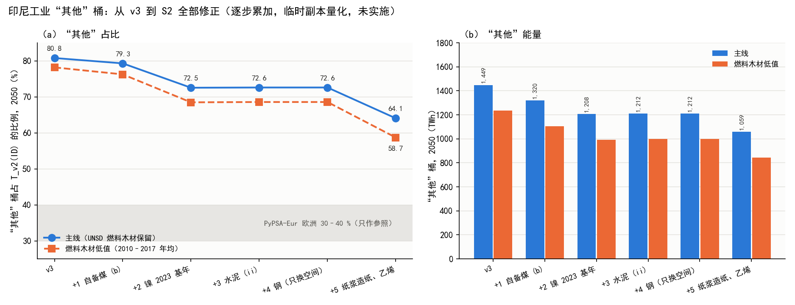

# v4 工业细分 S2：印尼补全（台账 W06，决策 203、204）

- **指令：** `V4_S2_INSTRUCTION.md` v1，SHA256 `95dcd3d846c34bbb631c8d8fb3f90c70e3bc28fd7187dd8cd9b29432816e6b01`，与 `V4_S2_SHA256.txt` 一致（2026-11-06 核对）。开始条件满足：S1 已推送（报告 `8ad5f7a9`、收尾 `b94d245f`）；`downloads/15_faostat/` 两个 csv 的 SHA256 与指令所列一致（FO `de61d07f…`，QCL `f340a946…`）。
- **分支：** `codex/v4-data-20261105`，worktree `/home/jin/wt_v4_data`，起点 `b94d245f`。交付目录 `research/06_scope_redesign/p1_v4_data_20261105/`，与 `work/p1_v4_data_20261105/` 同步（不含 `downloads/`、`extracted/`）。
- **性质：** 分析与量化。没有改仓库中的模型代码、配置、网络、注册表和 `T_v2`；求解器 0 次；没有下载新数据；没有碰 W11 的分支与文件，煤热值维持 v3 口径（25.8 GJ/t）。需要重跑数据链的量化都在仓库外临时副本 `/home/jin/v4s2/chain` 中进行：**未改动的副本逐位复现仓库 ID 行**（`T_v2` 1,793.677 TWh、v3"其他"1,449.044 TWh，偏差 0 MWh）。水泥修正 (ii) 用副本内一行补丁（从环境变量读粉磨电所用的 2019 年水泥吨数），无该变量时与原代码结果偏差 0 MWh。
- **标记：** 结论等级 EXACT（链运行或逐项可复现）、VERIFIED（读到的表或数组）、INFERENCE（推断或机制解释）、PROPOSED（建议，未实施）；数据等级 A 实际产量或统计、B 官方产能或带路线的全国统计、C 推导或代理、D 模型估计或无日期信息、E 缺失。报告中的数字都在 `V4_S2_EVIDENCE.json`（953 项，带来源、状态与等级）和 `s2/` 的表中，由 `scripts/v4s2_*.py` 生成。

## 0. 结论摘要

1. **合并量化（EXACT 链运行；各项修正为 PROPOSED，未实施）：** 按指令顺序逐步施加，ID 2050 年 `T_v2` / "其他"桶 / "其他"占比：v3 1,793.68 / 1,449.04 TWh / 80.8 % → (b) 自备煤中心值 1,665.01 / 1,320.38 / 79.3 % → 镍 2023 基年 1,665.01 / 1,207.70 / 72.5 % → 水泥 (ii) 1,668.98 / 1,211.67 / 72.6 % → 钢（只换空间）不变 → 纸浆造纸与乙烯 **1,653.78 / 1,059.40 TWh / 64.1 %**。全部合并后 `T_v2` −139.90 TWh、"其他" −389.64 TWh。自备煤低档 / 中档下合并结果为 64.6 % / 63.3 %。
2. **可加性：** 总量上各步单独施加之和与合并结果只差 −0.08 TWh（纸浆造纸的 2019 扣除按"其他"桶燃料结构分摊，而 (b) 先改变了这个结构）；分载体不可加（电 −4.57、>400 °C 有用热 +10.23 TWh 等），原因是 v3 守恒式把镍与新产品的扣减按"其他"桶的载体结构等比例分摊，(b) 把 75.89 TWh 煤换成 19.21 TWh 电之后结构变了。镍改基年与 (b) 两步在总量上严格可加（差 0.0000 TWh）。
3. **纸浆造纸（第 2.1 节）：** FAOSTAT 2019 年浆 8,889 kt（化学浆 7,807 A、溶解浆 700 E、机械与半化学浆 277 I、非木浆 105 I）、纸与纸板 11,953 kt（聚合项与子项逐项相等）。多数纸类品目自 2017 年（X）之后为结转值，化学浆最新实际年为 2023 年（A，9,789 kt）。2019 年能耗（FAOSTAT × JRC-IDEES EU27 2019 现状单耗）**62.57 TWh**（电 15.91、燃料 46.65），ID 没有 UNSD 造纸行，全部从"其他"扣；2050 年（PyPSA-Eur 2050 比，基年按"最后一个有新信息的年份"）**130.18 TWh**（电 33.39、生物质 95.42、低温热 1.38），字面 2024 年基年为 121.12 TWh。与 S0 预览（ETSAP × ODA 2018 年 75.9、2050 年 111.6 TWh）同量级。SFI 77 家厂全部落在陆上区域内，节点集中在 Java-Bali1 0（38.6 %）与廖内 Sumatra3 3（32.2 %）。
4. **乙烯（第 2.2 节）：** SFI 2019 年在运 1 套 860 kt（Chandra Asri），利用率 0.75 / 0.85 / 0.95（明确写出的假设，C）、高价值化学品 / 乙烯 = 1.697（GEM 同厂产能），只计能源用途 2019 年 3.58 / 4.05 / 4.53 TWh，从 UNSD 化工行（29.32 TWh）扣，**对"其他"桶的影响为 0（EXACT）**，化工行 `dispersed` 2050 年 50.51 → 43.52 TWh；显式乙烯 2050 年 12.16 / 13.79 / 15.41 TWh。审阅端对 S1 的更正（乙烯先扣化工行）得到确认。
5. **钢（第 1 节第 4 步）：** 总量不变，`T_v2` 与"其他"不变。设施法（有逐厂产量的按产量，其余 u ≤ 1）合计 15,830 kt，worldsteel 2024 年缺口 2,812 kt 主算归 IMIP 所在节点 Sulawesi0 3：该节点份额 52.6 %（v3 32.7 %，+19.9 个百分点），Java-Bali1 0 38.2 %（v3 59.3 %）。IMIP 2019 年末在运自备煤电 1,680 MW（Sulawesi Mining power station 7 台，GIPT 全部标为镍），德信 2020 年投产、不在 (b) 的 2019 基年内。
6. **燃料木材（第 3 节）：** UNSD 2019"燃料木材—未细分工业"65,253 千 m³ 带脚注"Estimate"。该行 2005–2017 年稳定在 2,862–3,126 万 m³，2018 年升到 6,593 万 m³，同年家庭从 7,486 万降到 3,560 万 m³，终端合计只变 −192 万 m³：**更像是家庭与工业之间的重新分配，而不是工业用量翻倍（INFERENCE）**。UNSD 的燃料木材进出口（2,146 / 1,368 万 m³）只出现在 2018–2019 年，FAO 同年木质燃料贸易不足 1 千 m³。自下而上的工业自产残渣（棕榈厂纤维与果壳 130–188、黑液 52、木材加工剩余物 1–20、蔗渣 12–15 TWh）量级不小，但除蔗渣外在 UNSD ID 都没有对应品种（没有黑液、没有"其他植物性残渣"）；HEESI 工业生物质 0.91 TWh 只是交易的生物质。**建议（PROPOSED）：** 主算改用 2010–2017 年均值 2,951 万 m³（74.95 TWh），合并情形下"其他"845.13 TWh（58.7 %）；2020–2021 年均值（59.7 %）作中档、UNSD 2019（64.1 %）作高档，HEESI 交易口径（53.0 %）只作极端下界；棕榈油压榨等自产残渣另作子部门决定（第 0.1 节第 1、5 问）。
7. **制糖与棕榈油（第 2.3–2.4 节）：** UNSD 蔗渣 6,964.7 kt 对 FAOSTAT 甘蔗 29.1 Mt 为 0.239 t/t（2010–2022 年 0.19–0.31），IRENA 2017 加工残渣系数 0.2 下为 5.82 Mt，一致性可接受。棕榈果 217 Mt（E）× IRENA 2022 质量平衡得纤维 31.25 Mt、果壳 13.89 Mt，按 15 GJ/t 为 130.2 + 56.5–57.9 TWh；UNSD 工业燃料木材序列在 2010–2017 年持平，而同期鲜果串 +74 %，所以该行并不是按棕榈残渣估的（INFERENCE）。**建议把"棕榈油压榨"列为显式子部门**（只提建议，第 2.4 节）。
8. **逐步变化与差距（第 4 节）：** 主线 80.8 → 64.1 %，燃料木材低值线 78.2 → 58.7 %（图 `s2/fig_s2_other_share_steps.png`）。距 30–40 % 参照区间还差 398–563 TWh。能量化的来源：燃料木材行 −179 至 −389、镍单耗取 NIUPPER −418（此时占比 38.8 %）、煤热值（需 W11）−16 至 −78、IBS 可归属的其他制造业 −122、制糖 −32 TWh（后三项为按"其他"桶自身换算的示意值）；MHP 与统一增长倍数无法量化。**只说明差距来源，不追求进入区间。**
9. **11 国自备电厂筛查（第 5 节）：** UNSD 2019 自备燃烧发电超过转换项燃料 100 % 可发电量的有 **ID**（32.80 TWh 燃料对 44.11 TWh 电）与 **TH**（64.36 TWh 电，转换项没有任何燃料）；BN、MM、PH、VN 不等式成立，但 GIPT 有 2019 年自备煤电（220 / 190 / 222 / 1,010 MW），建议 W07 核查；KH、LA、TL 没有自备电厂行。MY、SG 不等式成立且无自备煤电。
10. **MHP：** 仓库与本机（USGS MYB 2023、CREA/GEM 2025、IRENA、ETSAP）都没有高压酸浸单耗，只有产量（2022 年 9 万、2023 年 18 万 t Ni，估计值）与"6 个 HPAL 在建、年耗褐铁矿约 2,400 万 t"的描述。**MHP 留在余量**，所需文献见第 0.1 节第 7 问。
11. **对 S1 的两处更正：** 水泥修正 (ii) 的 2050 年影响是 **+3.97 TWh**（`T_v2` 与"其他"同增，临时副本重跑），S1 写的 +3.79 是多乘了一次 v3 缩放系数的解析近似；2019 年水泥扣除 −1.52 TWh 不变。

### 0.1 待决问题

1. **燃料木材主算值：** 维持 UNSD 2019（65,253 千 m³，165.74 TWh）、改用 2010–2017 年均（29,510 千 m³，74.95 TWh；本报告建议）、2020–2021 年均（35,369 千 m³，89.84 TWh），还是改为自下而上的子部门（第 5 问）？
2. **纸浆造纸基年规则：** 按"最后一个有新信息的年份"（化学浆 2023 A、多数纸类 2017 X；本报告主算），还是字面取 FAOSTAT 最近年份 2024（结转值；2050 年少 9.06 TWh）？
3. **纸浆造纸的生物质：** 2019 年扣除的燃料按 s3_0 的 spread 规则（主算，生物质只扣 15.70 TWh）还是"生物质优先"（扣 46.65 TWh，合并情形"其他"只差 +0.57 TWh，但分载体不同）？2050 年显式纸浆造纸含生物质 95.42 TWh（PyPSA-Eur 比），而 UNSD ID 没有黑液，是否接受？
4. **乙烯：** 利用率 0.75 / 0.85 / 0.95 与 HVC / 乙烯 1.697 是否接受？是否用 2025 年基年（含 LINE 1,000 kt，2050 年 26.55 TWh）？`downloads/16_chandra_asri/` 目前为空，若有 Chandra Asri 年报可替换利用率假设。
5. **新增显式子部门：** 是否把"棕榈油压榨"（自产纤维与果壳，2019 年 130–188 TWh）与"制糖"（蔗渣 13.38 TWh，v2 口径）列为显式子部门？若列入，自产残渣是否进入 `T_v2`（它同时是需求和燃料来源）？
6. **钢：** 2.81 Mt 缺口归 IMIP（主算）是否接受？IMIP 2019 年自备电是否部分供应不锈钢冶炼（GIPT 未区分；需 2019 年 IMIP 不锈钢产量与园区电力分配资料）？
7. **MHP 文献（由用户提供）：** 需要高压酸浸的分项单耗（高压釜蒸汽、电、石灰石与中和、硫酸厂焚硫副产蒸汽的净额）。候选（凭记忆列出，未核实）：Wei et al. 2020 原文中的其他 Case（v3 摄入时 PDF 未落盘）、Norgate & Jahanshahi (2011) 红土镍矿加工能耗、Nickel Institute 的 LCA 报告。
8. **镍单耗：** NIUPPER 敏感性下"其他"占比降到 38.8 %，是否需要更贴近印尼 NPI 的单耗文献再定主算？
9. **W07：** TH（64.36 TWh 自备燃烧发电无燃料记录）是否列入首批扩展？BN、MM、PH、VN 是否按 GIPT 名单核查？
10. **FAOSTAT 许可：** 登记表记为"待核"，请审阅端按 FAO 网站条款核实。

## 1. 已确认修正的合并量化（临时副本）

方法：`scripts/v4s2_common.py`（副本、输入编辑、补丁、v3 守恒层）、`scripts/v4s2_chain.py`；表 `s2/ID_S2_COMBINED.csv`、`s2/ID_S2_ADDITIVITY.csv`。

### 1.1 做法

- **副本与复现（EXACT）：** 复制 worktree 的 `research_inputs` 与 `scripts_project` 到 `/home/jin/v4s2/chain`，未改动时重跑 `s3_0_industry.py` 与 v3 分解，ID 行与仓库逐位一致（三项偏差均为 0 MWh）。
- **输入编辑：** `s3_0_industry.py` 按缓存份额拆分 D1 基数（`sub19 = e19 × cache / Σcache`）。ID 的煤、生物质、电缓存合计等于 D1 基数，气、油不等（133.52 对 120.17、95.21 对 90.89 TWh），所以从某一分行移出 d 时，缓存格减 `d × Σcache / e19`、D1 基数减 d，这样该分行正好减 d、其他分行不变。(b) 用 S1 的同一做法（煤 −C、电 +E）。
- **水泥 (ii)：** 副本内 `el19 = 电比 × 水泥吨` 一行改为读环境变量 `V4S2_CEM_EL_T19_ID`（取 USGS 2019 年 71.9 Mt），2019 年水泥扣除 −1.517 TWh（只改电）。
- **镍 2023 基年：** `v3_industry.nonferrous` 的 nf2023 结果只取镍（USGS 2023 含镍量 1,676 kt × G^((2050−2023)/28×0.5) × Wei Case 3），其余有色维持 2019 基年；NIUPPER 敏感性在此基础上乘 3.571。
- **新产品：** 纸浆造纸 2019 年能耗按 s3_0 对"没有对应 UNSD 行的产品"的 spread 规则从"其他"扣（电从电扣，燃料按当时"其他"桶燃料结构分摊）；乙烯按同一规则从化工行扣；2050 年显式量加到 `T_v2` 上，`其他 = T_v2 − Σ显式`（D163-6 a）。

### 1.2 单步与逐步累加（2050，TWh）

| 情形 | 2019 工业 | "其他" 2019（v2） | `T_v2`(ID) | Δ`T_v2` | "其他" | Δ"其他" | 占比 |
|---|---:|---:|---:|---:|---:|---:|---:|
| v3 | 774.44 | 633.14 | 1,793.68 | 0 | 1,449.04 | 0 | 80.8 % |
| 1 (b) 自备煤中心值 | 717.76 | 576.46 | 1,665.01 | −128.67 | 1,320.38 | −128.67 | 79.3 % |
| 2 镍 2023 基年（单独） | 774.44 | 633.14 | 1,793.68 | 0 | 1,336.37 | −112.68 | 74.5 % |
| 3 水泥 (ii)（单独） | 774.44 | 634.66 | 1,797.65 | +3.97 | 1,453.02 | +3.97 | 80.8 % |
| 4 钢（只换空间） | 774.44 | 633.14 | 1,793.68 | 0 | 1,449.04 | 0 | 80.8 % |
| 5 纸浆造纸 + 乙烯（单独） | 774.44 | 570.58 | 1,778.55 | −15.13 | 1,296.85 | −152.19 | 72.9 % |
| 1+2 | 717.76 | 576.46 | 1,665.01 | −128.67 | 1,207.70 | −241.34 | 72.5 % |
| 1+2+3 | 717.76 | 577.98 | 1,668.98 | −124.69 | 1,211.67 | −237.37 | 72.6 % |
| 1+2+3+4 | 同上 | | | | | | 72.6 % |
| **全部（1–5）** | **717.76** | **515.41** | **1,653.78** | **−139.90** | **1,059.40** | **−389.64** | **64.1 %** |

2019 年工业总量只在 (b) 中变化（−(1−η)C）；纸浆造纸与乙烯只是在分行之间重新归属，2019 年总量不变。第 5 步 `T_v2` 只降 15.13 TWh：从"其他"扣的 2019 年能耗按 ATS 倍数 2.62 与有用热换算在 2050 年为 152.19 TWh，而按实物产量重建的纸浆造纸只有 130.18 TWh（2050/2019 = 2.08），乙烯 +13.79、化工行 `dispersed` −6.99 TWh；钢 +0.09 TWh 是 v3 分解把氯碱副产氢冲抵在钢上（化工行变小后冲抵变少），不是钢的变化。

### 1.3 "其他"桶分载体变化（2050，TWh，对 v3）

| 情形 | 电 | <150 °C | 150–200 °C | 200–400 °C | >400 °C | 油（动力） |
|---|---:|---:|---:|---:|---:|---:|
| 1 (b) | +47.02 | −6.74 | −8.45 | −33.79 | −125.38 | −1.34 |
| 2 镍 2023 | −13.97 | −7.62 | −7.96 | −31.83 | −46.18 | −5.12 |
| 3 水泥 (ii) | +3.81 | +0.01 | +0.01 | +0.05 | +0.07 | +0.01 |
| 5 新产品 | −40.52 | −8.62 | −9.00 | −36.01 | −52.25 | −5.79 |
| **全部** | **−8.23** | **−23.90** | **−26.11** | **−104.42** | **−213.51** | **−13.47** |

合并后"其他"2050 年：电 171.40、<150 °C 74.09、150–200 °C 76.22、200–400 °C 304.90、>400 °C 380.42、油 52.37 TWh。

### 1.4 可加性（`s2/ID_S2_ADDITIVITY.csv`，EXACT）

| 量 | 单步之和 | 合并 | 差 |
|---|---:|---:|---:|
| Δ`T_v2` | −139.82 | −139.90 | −0.08 |
| Δ"其他" | −389.56 | −389.64 | −0.08 |
| 其中电 | −3.65 | −8.23 | −4.57 |
| 其中 >400 °C | −223.74 | −213.51 | +10.23 |
| 其中 200–400 °C | −101.57 | −104.42 | −2.85 |
| Δ"其他" 2019（v2） | −117.73 | −117.73 | 0 |

原因（INFERENCE，机制可复现）：(1) v3 守恒式按"其他"桶载体结构等比例扣除显式子部门，(b) 先把煤换成电，镍与纸浆造纸的扣减便更多地落在电上、更少地落在 >400 °C 热上（1+2 两步总量差 0.0000，电差 −5.37、>400 °C 差 +6.20）；(2) 纸浆造纸 2019 年扣除的燃料按当时"其他"桶燃料结构分摊，(b) 之后煤少了，扣减多取油、气、生物质，它们换算到 2050 年的系数不同（煤 2.357、油 2.445），总量上差 −0.08 TWh。

### 1.5 敏感性（合并情形上，2050）

| 情形 | `T_v2` | "其他" | 占比 |
|---|---:|---:|---:|
| 全部（主算） | 1,653.78 | 1,059.40 | 64.1 % |
| 自备煤低档（60.63 TWh） | 1,680.52 | 1,086.14 | 64.6 % |
| 自备煤中档（96.08 TWh） | 1,618.45 | 1,024.08 | 63.3 % |
| 镍 NIUPPER（2023 基年 × 3.571，镍 580.89 TWh） | 1,653.78 | 641.17 | 38.8 % |
| 纸浆造纸燃料"生物质优先" | 1,654.35 | 1,059.97 | 64.1 % |
| 纸浆造纸字面 2024 年基年 | 1,644.72 | 1,059.40 | 64.4 % |
| 乙烯利用率 0.75 / 0.95 | 1,652.97 / 1,654.59 | 1,059.40 | 64.1 % |
| 乙烯 2025 年基年（含 LINE） | 1,666.54 | 1,059.40 | 63.6 % |
| 燃料木材 2010–2017 年均（第 3 节） | 1,439.51 | 845.13 | 58.7 % |

### 1.6 钢：只换空间分配（第 4 步；`scripts/v4s2_steel.py`，`s2/ID_STEEL_NODE_SHARES_S2.csv`）

2019 年继续用 UNSD 钢铁行（不改 2019 扣除）。2050 年全国量用 v3（57.96 TWh）。设施法：有逐厂产量的按产量（Krakatau Steel 569 kt、GRP West Java 661 kt），其余在运产能 × u（u ≤ 1），合计 15,830 kt；worldsteel 2024 年 18,642 kt 与之差 **2,812 kt**。

| 节点 | 主算（缺口归 IMIP） | 敏感性 a（缺口按产能法厂比例，= S1） | 敏感性 b（按全部设施比例） | v3 | 主算 − v3 |
|---|---:|---:|---:|---:|---:|
| Java-Bali1 0 | 38.2 % | 44.3 % | 45.0 % | 59.3 % | −21.1 个百分点 |
| Java-Bali1 2 | 3.8 % | 4.5 % | 4.4 % | 3.3 % | +0.5 |
| Kalimantan4 4 | 5.4 % | 6.4 % | 6.3 % | 4.7 % | +0.7 |
| Sulawesi0 3 | **52.6 %**（30.51 TWh） | 44.8 % | 44.2 % | 32.7 % | **+19.9** |

Java-Bali1 0 的下降来自 Krakatau Steel 与 GRP 按实际产量计（远低于产能），Sulawesi0 3 的上升来自德信按产能（u = 1）加上整个缺口。

**电源核对（第 204 项第 5 条；`s2/ID_STEEL_POWER_CHECK.csv`）：** GIPT 的"Subnational unit"只到岛群一级，所以按距离德信厂 30 km 内取机组：2019 年末在运 1,680 MW（Sulawesi Mining power station 7 台，2015–2019 年投产，"Captive Industry Type"全部为 nickel），2020 年再投 400 MW（与德信投产同年），2021 年起 Labota 电站（aluminum, nickel）；附近没有标为钢铁的机组。结论（INFERENCE）：(b) 的 2019 基年中这 1,680 MW 计入镍，德信与 2.81 Mt 缺口都在 2019 年之后，不在 2019 基年里，因此**不与 (b) 的自备煤重复**；剩下的风险是 2019 年园区已有的不锈钢冶炼用电是否也来自这 1,680 MW——若是，这部分电在 (b) 之后进入"其他"并按 2.62 增长，而 2050 年显式钢又按 worldsteel 计入不锈钢，会有重复。S1 显示 2019 年镍自备发电（中档 10.47 TWh）与 Wei 口径镍用电（11.33 TWh）相当，提示重复不大，但 GIPT 不能拆分，列为第 0.1 节第 6 问。

### 1.7 MHP（高压酸浸）

在仓库（`research/`、`research_inputs/`、`scripts_project/`）与本机文献（`work/p2_data_intake/` 下的 PDF、`extracted/` 文本：USGS MYB 2023 印尼、CREA/GEM 2025、IEA WORLDBAL 文档、IRENA 2017 / 2022、ETSAP）中检索"HPAL / high-pressure acid / mixed hydroxide / leach"，只找到 USGS 的产量（MHP 含镍 2022 年 9 万 t、2023 年 18 万 t，均为估计值）与"Obi 岛 HPAL、年耗褐铁矿约 2,400 万 t、另有 6 个在建"的描述，**没有任何单耗**。按指令 MHP 暂留余量（它 2021 年才投产，不在 2019 基年里，2050 年只随"其他"桶的 GDP 增长隐含存在）。所需文献见第 0.1 节第 7 问。

## 2. 补产品（第 203 项）

方法：`scripts/v4s2_products.py`；表 `s2/ID_PULP_PAPER_FAOSTAT.csv`、`ID_PULP_PAPER_ENERGY.csv`、`ID_PULP_PAPER_MILLS_SFI.csv`、`ID_PULP_PAPER_NODES.csv`、`ID_ETHYLENE.csv`、`ID_ETHYLENE_UNITS_SFI.csv`、`ID_SUGAR_PALM_CHECK.csv`。

### 2.1 纸浆造纸

**FAOSTAT 品目、旗标与基年（VERIFIED 读数；基年规则 PROPOSED）：** 聚合项"化学木浆""印刷书写纸""其他纸与纸板"在 2019 年都等于其子项之和（差 0 t）。基年取"最后一个有新信息的年份"——其后的 E / I 值与它相同，是结转；从不变化的序列等级降为 D。

| 品目 | 2019（旗标） | 基年（旗标） | 基年产量 | 2050 主算 | PyPSA-Eur 部门 |
|---|---:|---|---:|---:|---|
| 化学木浆（硫酸盐漂白） | 7,807 kt（A） | 2023（A） | 9,789 kt | 16,502 kt | Pulp production |
| 溶解浆 | 700 kt（E） | 2021（E） | 1,200 kt | 2,103 kt | Pulp production（INFERENCE：同属化学浆） |
| 机械与半化学浆 | 277 kt（I） | 2021（A） | 0 | 0 | Pulp production |
| 非木浆 | 105 kt（I） | 2010（E，从未变化，D） | 105 kt | 228 kt | Pulp production |
| 新闻纸、铜版印刷书写纸、生活用纸、箱纸板、卡纸、包装纸、未细分纸 | 合计 8,953 kt（I） | 2017（X） | 同 2019 | ×1.893 | Paper production |
| 非涂布木浆印刷书写纸 | 3,000 kt（E） | 2019（E） | 3,000 kt | 5,464 kt | Paper production |
| **浆合计 / 纸合计** | **8,889 / 11,953 kt** | | | **18,832 / 22,415 kt** | |

字面取 2024 年为基年时 2050 年浆 18,343、纸 19,765 kt；按 2019 年为基年（v3 式）为 16,190 / 21,771 kt。PyPSA-Eur 只有一列"Pulp production"与一列"Paper production"，机械浆（电耗高）与回收纤维的差别不能分开；"Printing and media reproduction"不是造纸，不用。

**能耗（C）：**

| 口径 | 合计 | 电 | 燃料 / 生物质 | 浆 | 纸 |
|---|---:|---:|---:|---:|---:|
| 2019 扣除：FAOSTAT 2019 × JRC-IDEES EU27 2019 现状（浆 3.567、纸 2.581 MWh/t），载体按 PyPSA-Eur 比结构（S1 口径） | **62.57** | 15.91 | 46.65（其中生物质部分 45.99） | 31.71 | 30.86 |
| 2019 ETSAP BAT（不乘 ODA） | 57.05 | | | 36.79 | 20.25 |
| 2019 ETSAP BAT × ODA（S0 预览的方法） | 83.40 | | | 54.13 | 29.27 |
| S0 预览：2018 年 ETSAP × ODA（化学浆 7.85 + 纸 11.47 Mt） | 75.9 | | | | |
| **2050 主算**（PyPSA-Eur 2050 比） | **130.18** | 33.39 | 生物质 95.42 | | 低温热 1.38 |
| 2050 字面 2024 基年 / 2019 基年 | 121.12 / 118.79 | | | | |
| S0 预览：2050（PyPSA-Eur 比 × 1.857） | 111.6 | | | | |

**2019 扣除（扣减顺序，S0 第 3.2 节）：** ID 没有 UNSD 造纸行，全部从"其他"扣。单独施加时（spread 规则）扣煤 20.06、油 6.47、气 6.33、生物质 13.79、电 15.91 TWh；合并情形（(b) 之后）扣煤 16.39、油 7.36、气 7.20、生物质 15.70、电 15.91 TWh。(b) 已把造纸自备煤（中心值 21.08 TWh）换成电，造纸用电的扣减因此由这部分电承担，不重复。

**生物质核对线（第 3 节）：** PyPSA-Eur 结构下纸浆造纸 2019 年生物质用量 45.99 TWh；化学浆与溶解浆按 ETSAP 22 GJ/t 产生黑液 51.99 TWh。UNSD ID 没有黑液品种，"其他"行的生物质 165.95 TWh（v2 口径）中 148.54 TWh 是燃料木材一行。spread 规则只从生物质扣 15.70 TWh，"生物质优先"扣 46.65 TWh（第 1.5 节敏感性）。

**空间分配（SFI 2025-07；`s2/ID_PULP_PAPER_NODES.csv`）：** ID 77 家厂全部点入陆上区域。浆：8 家有产能（13.34 Mt），全国 2019 年浆 / 产能 = 0.666，按产能分；纸：5 家有产能（6.58 Mt，按产能计），其余 5.37 Mt 平均分给 64 家无产能值、非纯浆厂（D）。

| 节点 | 纸浆造纸 2050 份额 | v3"其他"份额 |
|---|---:|---:|
| Java-Bali1 0 | 38.6 % | 32.6 % |
| Sumatra3 3（廖内） | 32.2 % | 6.5 % |
| Sumatra3 1 | 13.7 % | 4.7 % |
| Java-Bali1 2 | 6.3 % | 14.3 % |
| Sumatra3 4 | 4.7 % | 2.6 % |
| Sumatra3 2 / Java-Bali1 1 | 1.9 % / 1.7 % | 3.7 % / 12.5 % |

只按已知纸产能分配的敏感性见表中 `paper_share_known_only` 列。

### 2.2 乙烯（高价值化学品）

| 项 | 值 | 出处与等级 |
|---|---:|---|
| 2019 年在运产能 | 860 kt 乙烯（Chandra Asri，1995 年投产；GEM 记 900 kt） | SFI 2025-12（B） |
| 利用率 | 低 0.75 / 中 0.85 / 高 0.95 | 明确假设（C）：没有逐厂产量 |
| HVC / 乙烯 | 1.697 | GEM GCT 2026-11 同厂在运产能：乙烯 900、丙烯 490、丁二烯 137 kt（C） |
| 能源用途单耗 | 3.269 MWh/t HVC | JRC-IDEES EU27 2019 基础化学品能源用途 − 氨、氯、甲醇（s3_0 的拆分）÷ 52 Mt（EXACT，C） |
| 对照：ETSAP BAT / BAT × ODA | 3.333 / 7.825 MWh/t 烯烃 | 路线表；ODA 化工系数不宜按产品用 |
| **2019 能源用途** | **3.58 / 4.05 / 4.53 TWh**（ETSAP BAT 3.32 / 3.76 / 4.21；BAT × ODA 7.80 / 8.83 / 9.87） | INFERENCE |
| 2050（× 1.8214，PyPSA-Eur HVC 比不含石脑油 6.103 MWh/t） | **12.16 / 13.79 / 15.41 TWh**（中档：电 5.54、气 7.44、氢 0.39、低温热 0.41） | PROPOSED |
| 2025 年基年（含 LINE 1,000 kt；SFI 记在建，GEM 记 2025 年在运） | 2050 年 26.55 TWh | R4 敏感性 |

原料（石脑油 42.5 GJ/t）属 NEU，不在 `T_v2` 内。扣减从 UNSD 化工行（2019 年 29.32 TWh）按 spread 规则：煤 2.28、油 0.25、气 1.14、生物质 0.05、电 0.34 TWh（电份额按 ETSAP BAT 1 / 12）。**对"其他"桶的影响为 0（EXACT）**，化工行 `dispersed` 2050 年 50.51 → 43.52 TWh，`T_v2` 净变化 +6.80 TWh（含在第 5 步内）。

### 2.3 制糖（只作一致性核对）

FAOSTAT 2019 年甘蔗 29.1 Mt（X）、原糖 2.227 Mt（A）。IRENA 2017 表 R3 的甘蔗加工残渣系数 0.2 t/t（仓库 `biomass_v5/sources` 已登记）得蔗渣 5.82 Mt；UNSD 蔗渣 6,964.7 kt，相当于 0.239 t/t，为 IRENA 量的 1.20 倍；2010–2022 年 UNSD / FAOSTAT 比值在 0.19–0.31 之间（`s2/ID_SUGAR_PALM_CHECK.csv`）。按上游 7.72 GJ/t，UNSD 蔗渣 14.93 TWh（扣水泥后 v2 口径 13.38 TWh），IRENA 量对应 12.48 TWh。**结论（INFERENCE）：** UNSD 蔗渣量与甘蔗产量相容，S1 把 13.38 TWh 归制糖可以保留。

### 2.4 棕榈油压榨（核对线与建议）

| 项 | 2019 | 出处 |
|---|---:|---|
| 棕榈果（鲜果串） | 217 Mt（E） | FAOSTAT QCL |
| 毛棕榈油 / 棕榈仁 | 47.12 Mt（A）/ 10.43 Mt（X）；出油率 21.7 % | FAOSTAT QCL |
| 质量平衡（每吨鲜果串） | 纤维 0.144、果壳 0.064、空果串 0.21、废水 0.583、毛油 0.24 | IRENA 2022 第 40 页框 4（引 Eriza 2010；仓库已登记） |
| 纤维 / 果壳 / 空果串 | 31.25 / 13.89 / 45.57 Mt | 推导（C） |
| 热值 | 15 GJ/t（IRENA 2017 第 7 页残渣约定，含水率未注明）；果壳 NCV > 3,500 kcal/kg（ERIA/IEEJ 2024 表 3.8） | |
| 纤维能量 / 果壳能量 | 130.2 / 56.5–57.9 TWh | INFERENCE |
| 压榨厂燃料（纤维全烧；纤维 + 全部果壳） | **130.2–188.1 TWh** | INFERENCE；IRENA 2022 第 39 页：压榨厂多用纤维与果壳烧锅炉、自带汽轮发电 |

UNSD ID 没有"其他植物性残渣"品种。工业燃料木材 2010–2017 年持平（2,862–3,026 万 m³），同期鲜果串从 111 增到 193 Mt（+74 %），两序列 2010–2022 年相关系数 0.55 只来自 2018–2019 年的跳变，所以该行不是按棕榈残渣估的（INFERENCE）。果壳出口量本机没有（FAOSTAT 不含），高档（果壳全烧）是上界。

**建议（只提建议）：** 把"棕榈油压榨"列为显式子部门：活动量用 FAOSTAT 毛棕榈油（A 级）或鲜果串；能耗以自产纤维、果壳供汽与自发电为主，不是电网负荷；与"其他"桶的关系取决于第 0.1 节第 1、5 问（若燃料木材行改为低值，压榨厂自产残渣是否作为新的显式需求进入 `T_v2`，同时作为生物质来源）。空间上需要压榨厂位置数据（本机没有，Climate TRACE 食品饮料烟草行业可作候选，需核对覆盖）。

## 3. 燃料木材核对（第 204 项第 4 条）

方法：`scripts/v4s2_biomass.py`；表 `s2/ID_BIOMASS_UNSD_2019.csv`、`ID_FUELWOOD_SERIES.csv`、`ID_BIOMASS_COMPARISON.csv`、`ID_FUELWOOD_OPTIONS.csv`。

### 3.1 定义

- **UNSD：** 导出的商品代码表（`unsd_targeted/codelists.json`）为 5110 燃料木材、5120 蔗渣、5130 动物粪便、5140 黑液、5150 其他植物性材料与残渣、5160 木炭（VERIFIED）。按代码对齐，5110 对应 IRES / SIEC 511"燃料木材、木材残余物与副产品"，即包括锯末、木片等加工剩余物（INFERENCE：本机没有 IRES 原文）。棕榈纤维、果壳应属 5150，黑液属 5140——ID 2019 年这两个品种都没有报。
- **FAO：** "Wood fuel"是用作燃料的原木；FAOSTAT 把木材剩余物、木片与碎料、颗粒、型块、木炭作为独立品目分列（VERIFIED，见文件品目）。所以 FAO 木质燃料不含加工剩余物，口径比 UNSD 5110 窄。
- **上游折算：** pypsa-asean `get_conv_factors`（提交 `ce327bfa`）燃料木材 0.00254 TWh / 千 m³（9.144 GJ/m³）、蔗渣 0.002144 TWh / 千 t（7.72 GJ/t）、木炭 0.00819、生物柴油 0.01022；注释称出自 UNSD 2014 能源平衡方法文件（本机无原文，B）。HEESI 2025 附录 03：薪柴 2.2979 BOE/t（13.50 GJ/t）、木炭 4.9713 BOE/t。

### 3.2 UNSD 2019 印尼全部生物质品种与交易项（VERIFIED）

| 品种 | 交易项 | 量 | TWh | 脚注 |
|---|---|---:|---:|---|
| 燃料木材 | 生产 / 进口 / 出口 | 103,761 / 21,460 / 13,684 千 m³ | 263.55 / 54.51 / 34.76 | |
| | 炭窑投入 | 10,764 千 m³ | 27.34 | |
| | 终端消费 | 100,773 千 m³ | 255.96 | Estimate |
| | 工业（化工 129、**未细分 65,253**） | 65,382 千 m³ | 166.07（未细分 **165.74**） | Estimate |
| | 家庭 / 其他未细分 | 33,621 / 1,770 千 m³ | 85.40 / 4.50 | |
| 蔗渣 | 生产 = 工业未细分 | 6,964.7 千 t | 14.93 | |
| 木炭 | 生产 1,794、出口 527、工业 97.7、商业 1,403、家庭 18.5 千 t | | 工业 0.80 | |
| 生物柴油 | 工业未细分 362 千 t（交通 4,613） | | 3.70 | |
| 沼气 | 家庭 525.5 TJ | | 0.15 | |
| 黑液、其他植物性残渣、动物粪便 | 无记录 | | | |

**序列（`s2/ID_FUELWOOD_SERIES.csv`，百万 m³）：**

| 年 | 工业未细分 | 家庭 | 终端合计 | UNSD 生产 | FAO 木质燃料（E） | UNSD / FAO |
|---|---:|---:|---:|---:|---:|---:|
| 2010 | 29.01 | 132.02 | 161.96 | 167.81 | 59.74 | 2.81 |
| 2017 | 29.69 | 74.86 | 105.44 | 113.04 | 44.21 | 2.56 |
| **2018** | **65.93** | **35.60** | 103.53 | 98.72 | 42.28 | 2.34 |
| **2019** | **65.25** | **33.62** | 100.77 | 103.76 | 40.41 | 2.57 |
| 2020 | 34.94 | 21.64 | 57.45 | 62.31 | 38.60 | 1.61 |
| 2021 | 35.80 | 9.09 | 45.77 | 50.46 | 36.88 | 1.37 |
| 2022 | 44.18 | 28.12 | 74.14 | 74.15 | 35.21 | 2.11 |

2005–2017 年工业行在 28.6–31.3 之间，2010–2017 年均 29.51；2017 → 2018 年工业 +36.23、家庭 −39.26、终端合计 −1.92。UNSD 燃料木材进出口只在 2018–2019 年出现；FAO 2019 年木质燃料进口 78 m³、出口 902 m³（X）。**判断（INFERENCE）：** 2018–2019 年工业行的翻倍是同一估计序列在家庭与工业之间的重新分配，不对应可识别的工业活动；2020 年起序列整体不稳（终端合计 57.45 → 45.77 → 74.14）。

### 3.3 自下而上（2019，TWh，INFERENCE）

| 块 | 低 | 高 | 依据 | 在 UNSD ID 中 |
|---|---:|---:|---|---|
| 纸浆厂黑液（化学浆 + 溶解浆 × 22 GJ/t，ETSAP） | 51.99 | 51.99 | 路线表注 | 无黑液品种 |
| （对照）PyPSA-Eur 纸浆造纸生物质用量 | 45.99 | 45.99 | 第 2.1 节 | — |
| 棕榈压榨厂纤维（低）+ 果壳（高） | 130.20 | 188.07 | 第 2.4 节 | 无"其他植物性残渣" |
| 制糖蔗渣（IRENA 量 / UNSD 量） | 12.48 | 14.93 | 第 2.3 节 | 有（蔗渣） |
| 木材加工剩余物：FAOSTAT"木材剩余物"388 千 m³（低）/ 锯材 2.70 + 胶合板 4.51 百万 m³ 按 FAO 2001 印尼出材率 46 % / 50 %（高，7.68 百万 m³） | 0.99 | 19.51 | FAOSTAT FO；FAO 2001 表 9（IUFRO 1992）；9.144 GJ/m³ | 可能在燃料木材中 |

树皮、木片自用、橡胶木等没有本机系数，未估。

### 3.4 对照表（`s2/ID_BIOMASS_COMPARISON.csv`）

| 来源 | 项 | TWh | 范围 |
|---|---|---:|---|
| UNSD 2019 | 燃料木材—未细分工业（Estimate） | 165.74 | 工业 |
| UNSD 2019 | 蔗渣 / 木炭 / 生物柴油 / 化工燃料木材 | 14.93 / 0.80 / 3.70 / 0.33 | 工业 |
| UNSD 2019 | 燃料木材—家庭 / 终端合计 | 85.40 / 255.96 | 家庭 / 全部 |
| FAOSTAT 2019 | 木质燃料（非针叶，E）× 9.144 GJ/m³ | 102.64 | 全国全部用途（原木） |
| HEESI 2025 | 工业生物质（表 3.3） | 0.91 | 工业（交易的生物质；2023 / 2024 年 20,452 / 53,147 千 BOE） |
| HEESI 2025 | 传统生物质（表 3.3，估计） | 39.85 | 家庭 |
| 自下而上 | 黑液 + 棕榈纤维与果壳 + 蔗渣 + 木材剩余物 | 195.7–274.5 | 工业自产残渣 |

**能对上的：** 蔗渣（UNSD 与甘蔗产量相容）；生物柴油（B20 掺混）。**对不上的：** (1) UNSD 燃料木材全国量是 FAO 木质燃料的 2.6 倍，FAO 口径窄只能解释一部分；(2) 工业行 2018–2019 年翻倍、进出口只在两年出现，与 FAO 贸易不符；(3) HEESI 工业生物质只计交易的生物质，与 UNSD 165.74 TWh 不是同一口径；(4) 自产残渣（棕榈、黑液）量级很大，但 UNSD ID 没有相应品种，无法判断燃料木材行是否意在覆盖它们——从 2010–2017 年序列持平看，不是。

### 3.5 建议（PROPOSED，不实施）

| 候选（燃料木材—未细分工业） | 2019 TWh | v3 上："其他" / 占比 | 合并情形："其他" / 占比 | `T_v2` 合并 |
|---|---:|---|---|---:|
| UNSD 2019（现状，高档） | 165.74 | 1,449.04 / 80.8 % | 1,059.40 / 64.1 % | 1,653.78 |
| UNSD 2020–2021 年均（中档） | 89.84 | 1,270.05 / 78.7 % | 880.27 / 59.7 % | 1,474.64 |
| **UNSD 2010–2017 年均（建议主算）** | **74.95** | 1,234.94 / 78.2 % | **845.13 / 58.7 %** | 1,439.51 |
| HEESI 交易生物质（极端下界，不建议） | 0.91 | 1,060.28 / 75.5 % | 670.26 / 53.0 % | 1,264.63 |

理由：2010–2017 年是同一估计序列在跳变前的稳定水平，且与 FAO 木质燃料的下降趋势同期；2019 年值带"Estimate"脚注并伴随家庭同量下降。HEESI 只覆盖交易生物质，而棕榈、纸浆厂的自产残渣确实存在，所以不宜作主算。若用户决定把棕榈油压榨、纸浆厂黑液作为显式子部门，燃料木材行应再扣除其中被认定为这些残渣的部分，避免重复。**需要用户决定的问题：** 第 0.1 节第 1、3、5 问。可补的数据：UNSD 对 ID 燃料木材估计方法的说明、印尼农业部或 GAPKI 的压榨厂能源数据、APKI 的纸浆造纸能源数据、FAO 木材转换系数手册。

## 4. 印尼"其他"占比的逐步变化

方法：`scripts/v4s2_stepwise.py`；表 `s2/ID_OTHER_SHARE_STEPS.csv`、`s2/ID_OTHER_GAP_SOURCES.csv`；图 `s2/fig_s2_other_share_steps.png`。

| 步 | "其他" 2050（TWh） | 本步变化 | 占比 | 燃料木材低值线："其他" / 占比 |
|---|---:|---:|---:|---|
| v3 | 1,449.04 | — | 80.8 % | 1,234.94 / 78.2 % |
| +1 自备煤 (b) | 1,320.38 | −128.67 | 79.3 % | 1,106.23 / 76.2 % |
| +2 镍 2023 基年 | 1,207.70 | −112.68 | 72.5 % | 993.56 / 68.5 % |
| +3 水泥 (ii) | 1,211.67 | +3.97 | 72.6 % | 997.53 / 68.6 % |
| +4 钢（只换空间） | 1,211.67 | 0 | 72.6 % | 997.53 / 68.6 % |
| +5 纸浆造纸、乙烯 | **1,059.40** | −152.27 | **64.1 %** | **845.13 / 58.7 %** |

**与 30–40 % 参照区间的差距（只作说明，不作目标）：** 合并情形 `T_v2` 1,653.78 TWh 的 30–40 % 为 496–662 TWh，"其他"还多 398–563 TWh。

| 来源 | 2050 量级（TWh） | 依据与等级 | 需要什么才能判断 |
|---|---:|---|---|
| 燃料木材行（第 3 节） | −179 至 −389 | 链运行（PROPOSED） | 用户决定 |
| 镍单耗取 NIUPPER | −418 | 链运行（PROPOSED） | 更贴近 NPI 的单耗文献 |
| 煤热值：剩余"其他"煤（2019 年 154.18 TWh）按 HEESI 24.67 / 20.29 GJ/t | −16 至 −78 | 示意值（INFERENCE）：× (1 − 比值) × 2.357 | **W11**（本会话不改热值） |
| IBS 可归属的食品、纺织、木材、橡塑、非金属（不含水泥）、机械、运输设备、其他制造（2019 年 48.95 TWh，下界） | −122 | 示意值（INFERENCE）：按"其他"桶自身换算（煤气生物质 2.357、油 2.445、电 2.619） | 这些子部门的显式路线（W07 / W08）；IBS 只覆盖 12 % |
| 制糖（蔗渣 13.38 TWh） | −32 | 示意值 | 是否列为显式子部门 |
| MHP | 无法量化 | — | HPAL 单耗文献 |
| 统一增长倍数 2.62 对实物产量增长（纸浆造纸 2050/2019 = 2.08） | 无法量化 | 结构性 | W08 设计 |

**解释（INFERENCE）：** 欧洲模型的"其他"只是 PyPSA-Eur 三十多个部门之一，食品、纺织、机械、运输设备等都有单独的部门；而 ID 的 UNSD 只有化工、钢铁、"其他"三行，这些行业在构造上都在"其他"里。剩余差距主要来自 (1) 统计上不可拆分的行业（需要国家统计或 IBS 之外的数据），(2) 燃料木材行的估计问题，(3) 镍冶炼单耗的不确定性（NIUPPER 一项就够进入区间），(4) 煤热值（W11）。

## 5. 东盟 11 国自备电厂筛查（只读，供 W07）

方法：`scripts/v4s2_captive_screen.py`；表 `s2/ASEAN11_AUTOPRODUCER_FUEL_2019.csv`、`s2/ASEAN11_CAPTIVE_SCREEN.csv`。不等式同 S1 第 1.2 节：UNSD 2019 自备燃烧发电对转换项燃料按技术数据 v0.15.0 2050 效率（煤 0.356、褐煤 0.33、气 CCGT 0.60、油 0.35、固体生物质 0.468、沼气按 OCGT 0.43，均为 2019 年电厂的上界）与 100 % 可发的电量。

| 国家 | 自备燃烧发电 GWh | 转换项燃料 TWh | 效率上界可发 GWh | 隐含效率 | 判定 | GIPT 2019 年末自备煤电 MW（类型） | 建议 |
|---|---:|---:|---:|---:|---|---|---|
| **ID** | 44,112.9 | 32.80 | 14,732.7 | **1.34** | **超过 100 %（EXACT）** | 5,924（镍 2,572、造纸 1,601…） | S1 已完成 |
| **TH** | 64,358.4 | 0 | 0 | — | **超过 100 %（EXACT）**：转换项无燃料 | 582（炼油 362、水泥 150、纺织 36、造纸 34） | **W07 扩展**；隐含小时 > 8,760 h，未解释的发电不可能全是煤（多为燃气、生物质自备电厂，INFERENCE） |
| VN | 4,200.0 | 33.76 | 13,930.7 | 0.12 | 成立（投入偏大） | 1,010（钢铁 900、农业 60、造纸 50） | W07 核查（"其他"桶煤 99.05 TWh） |
| MM | 10,929.1 | 21.51 | 12,908.7 | 0.51 | 成立 | 190（钢铁 120、水泥 70） | W07 核查 |
| PH | 1,015.1 | 3.93 | 1,837.8 | 0.26 | 成立 | 222（炼油 140、造纸 82） | W07 核查 |
| BN | 911.9 | 3.01 | 1,448.6 | 0.30 | 成立 | 220（化工） | W07 核查 |
| MY | 7,084.1 | 19.29 | 11,157.6 | 0.37 | 成立 | 0（自备油气 150） | 无 |
| SG | 4,497.0 | 13.61 | 7,939.9 | 0.33 | 成立 | 0（自备油气 7,164） | 无 |
| KH、LA、TL | 无自备电厂行 | | | | 不可检验 | 0 | 无 |

注：BN 的"Brown coal"与"Lignite"两行同为 341.064 千 t，只计一次。VN 的隐含效率 0.12 说明转换项投入可能含供热或口径偏大，反向问题也需要 W07 核查。只出筛查表与建议，没有估算、没有改动。

## 6. 方法模板（供 W07）

`s2/V4_METHOD_TEMPLATE.csv`：11 步（0 复现 → 1 国家统计基数 → 2 自备电厂不等式 → 3 实物产量与基年 → 4 熟料比 → 5 有色基年 → 6 新产品扣减 → 7 生物质定义核对 → 8 空间分配 → 9 合并量化 → 10 产出与证据），每步列出每国需要的数据（FAOSTAT FO / QCL、USGS MYB、worldsteel、GEM、SFI、国家统计）、必做核对（复现偏差 0、自备电厂不等式、聚合项 = 子项、旗标与等级、2018–2019 或 2021–2022 口径跳变、熟料比、基年规则 R1–R4、扣减不超过所在行、生物质品种对应、单节点差 > 5 个百分点逐厂说明、可加性）、产出表的文件名与关键列、等级规则和 S1 / S2 出处。

## 7. 新文件登记

`DATA_REGISTRY_V4_DOWNLOADS.csv` 追加 2 行（`scripts/v4s2_registry.py`；原 40 行逐字节未动）：

| 文件 | 字节 | SHA256（前 16 位） | 内容 | 许可 |
|---|---:|---|---|---|
| `15_faostat/FAOSTAT_data_en_11-6-2026 (2).csv` | 2,790,920 | de61d07f1801c3f0 | FO 林产品生产与贸易；东盟 11 国，2010–2024 年；生产、进口、出口；15,610 行；旗标 A / E / I / X | **待核**（FAO 网站条款；文件内无许可或发布日期） |
| `15_faostat/FAOSTAT_data_en_11-6-2026.csv` | 3,263,949 | f340a9468f09d8a2 | QCL 作物与畜产品；东盟 11 国，2010–2024 年；17,970 行；旗标 A / E / I / M / X | **待核** |

来源网址记为 FAOSTAT 数据页（https://www.fao.org/faostat/en/#data/FO、/QCL；文件内没有地址），下载日期 2026-11-06（文件名日期；00:24 / 00:27 放入）。两个 csv 不进仓库，只提交 `s2/` 的派生表。`downloads/16_chandra_asri/` 是空目录，S2 未使用。

## 8. 产出、提交与停止条件

| 产出 | 位置 |
|---|---|
| 报告 | `V4_S2_ID_REPORT.md` |
| 表格 | `s2/ID_S2_COMBINED.csv`、`ID_S2_ADDITIVITY.csv`、`ID_STEEL_NODE_SHARES_S2.csv`、`ID_STEEL_POWER_CHECK.csv`（第 1 节）；`ID_PULP_PAPER_FAOSTAT.csv`、`ID_PULP_PAPER_ENERGY.csv`、`ID_PULP_PAPER_MILLS_SFI.csv`、`ID_PULP_PAPER_NODES.csv`、`ID_ETHYLENE.csv`、`ID_ETHYLENE_UNITS_SFI.csv`、`ID_SUGAR_PALM_CHECK.csv`（第 2 节）；`ID_BIOMASS_UNSD_2019.csv`、`ID_FUELWOOD_SERIES.csv`、`ID_BIOMASS_COMPARISON.csv`、`ID_FUELWOOD_OPTIONS.csv`（第 3 节）；`ID_OTHER_SHARE_STEPS.csv`、`ID_OTHER_GAP_SOURCES.csv`、`fig_s2_other_share_steps.png`（第 4 节）；`ASEAN11_AUTOPRODUCER_FUEL_2019.csv`、`ASEAN11_CAPTIVE_SCREEN.csv`（第 5 节）；`V4_METHOD_TEMPLATE.csv`（第 6 节）；各节证据片段 `s2/_*.json` |
| 证据 | `V4_S2_EVIDENCE.json`（953 个数字：EXACT 118、VERIFIED 291、INFERENCE 114、PROPOSED 428、待核 2） |
| 脚本 | `scripts/v4s2_common.py`、`v4s2_products.py`、`v4s2_chain.py`、`v4s2_steel.py`、`v4s2_biomass.py`、`v4s2_stepwise.py`、`v4s2_captive_screen.py`、`v4s2_registry.py`、`v4s2_summary.py` |
| 登记 | `DATA_REGISTRY_V4_DOWNLOADS.csv`（+2 行） |
| 进度 | `V4_S2_PROGRESS.md`（提交号与推送结果在最后一行） |
| 不进仓库 | `downloads/`（含两个 FAOSTAT csv）、`extracted/`；仓库外临时副本 `/home/jin/v4s2/chain` |

- **提交：** S2-A `58ec0573`（第 2 节）→ S2-B `fd679b45`（第 1 节）→ S2-C `8b8f4884`（第 3 节）→ S2-D `34f1b53a`（第 4–5 节）→ S2-E（第 6–7 节、本报告、证据、台账条目）；报告不能写自己的提交号，见 `V4_S2_PROGRESS.md` 最后一行。
- **额度：** 求解器 0 次；本机计算约 5 分钟（数据链每次重跑约 1 秒，第 1 节 18 个情形 19 秒，第 3、4 节各约 15 秒）；新增磁盘约 0.1 GB（临时副本 99 MB）；没有下载新数据。
- **停止条件：** 指令 SHA256 相符；没有改模型代码、配置、网络、注册表或 `T_v2`（所有量化在仓库外副本中）；没有调用求解器；未改动副本逐位复现仓库 ID 行；没有泄露许可内容或登录信息（每次提交前隐私扫描无命中）。均未触发。
