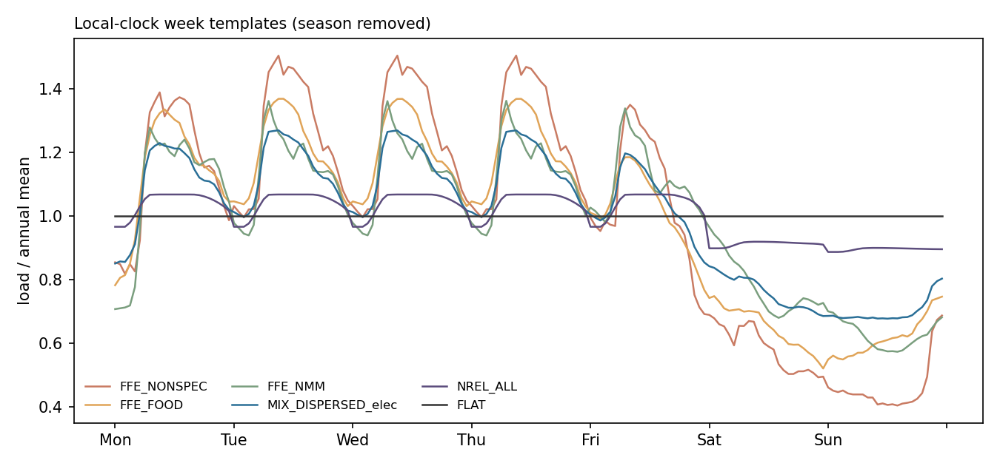
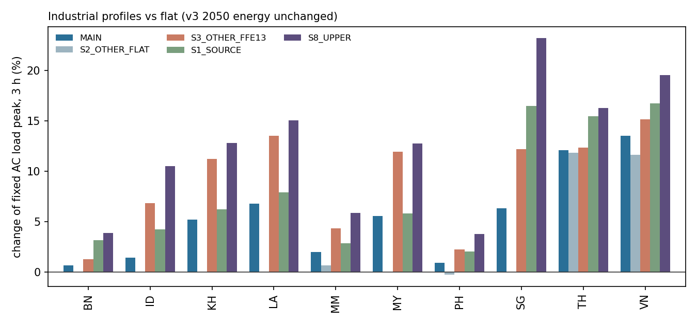

# V4 W07 G5：工业小时曲线（设计与数据）

- **指令：** `V4_W07_INSTRUCTION.md` v1，SHA256 `20d03b692f1d32733f34b04d85c01fb3df1345f95f366a6bf25de36ac7ec7baf`，与 `V4_W07_SHA256.txt` 一致；本会话只执行 B-G5 节。
- **分支：** `codex/v4-w07-g5-20261106`（起点 `07e08f38`，即 `codex/v4-data-20261105` 当前头）；worktree `/home/jin/wt_v4_g5`；交付目录 `work/p1_v4_w07_20261106/G5/` = 仓库 `research/06_scope_redesign/p1_v4_w07_20261106/G5/`。
- **性质：** 只做设计与数据。没有改网络、代码、配置、注册表或 `T_v2`；求解器 0 次；没有下载数据（只读了 FfE 与 NREL 数据集网页上的许可说明）。
- **数量口径：** 峰值估计用 v3 2050 年工业量（`INDUSTRY_2050_SUBSECTOR_CARRIER_V3.csv` 主算）与 v3.1 F1 网络（`integrated_2920_3h_unsolved.nc`，SHA256 `8b5fd663…`）。G0–G4 的 v4 数字出来后，`scripts/g5_peaks.py` 换一张构成表即可重算。

## 0. 结论摘要与待决问题

### 0.1 结论

1. **模型快照是 UTC（VERIFIED）。** 2,920 个 3 小时快照，2013-01-01 00:00 至 2013-12-31 21:00，不带时区标记。11 国光伏出力峰都落在快照 03 或 06 时（UTC）；1 小时 atlite 曲线的日质心比 UTC 太阳正午晚 0.98 h（中位数，5–95 % 为 0.82–1.48 h；若是当地时钟应晚约 7 h）；基础电力负荷峰在快照 09–12 时（当地傍晚）。天气年 2013，2013-01-01 是周二。
2. **工业负荷按"节点 × 载体"聚合，不分子部门（VERIFIED）。** 网络中 `industry electricity`（95 个）、`industry heat`、`industry heat high / medium A / medium B`（各 92 个）等全部是恒定 `p_set`。所以 W08 需要按节点内各子部门的能量加权合成曲线。v3 子部门表按国家、按 ID 时区汇总的工业用电与网络完全一致（最大偏差 4e-7 MWh，EXACT），可以直接用作权重。
3. **时区（VERIFIED）。** 96 个 AC 节点：MM 17 个 +6:30；TH 6、VN 8、KH 5、LA 6、ID 16 个 +7；MY 7、SG 1、PH 5、BN 1、ID 17 个 +8；ID 6、TL 1 个 +9。ID 的规则：节点代表点所在省（GADM 4.1 `NAME_1`）→ 法定时区（WIB +7 / WITA +8 / WIT +9），与决策 165 的表逐节点一致（0 处不符）。5 个 ID 节点有 6–26 % 的面积在相邻时区（v3 2050 工业用电合计 9.32 TWh），建议仍取单一法定时区。**不能按经度划分**：按经度规则会把东爪哇节点 `ID_Java-Bali1 2`（35.4 TWh）等 4 个节点划错。
4. **FfE 文件的日期对齐成立，时钟无法判定。** 检出 11 个异常低的工作日，全部是 2017 年德国节假日，所以文件第 0 天就是 2017-01-01（周日）（VERIFIED）。冬夏日内形状对照：5 条曲线中 4 条在同一索引小时（滞后 0，相关 0.9998），只有非金属矿物滞后 1 h，不能断定是当地时钟还是 UTC。主算沿用 S0 的提议，按德国当地时钟处理；UTC 解读（S4）只让东盟峰值增量变化 +1.1 GW。
5. **去季节、保留周内与日内结构。** 每条源曲线取全年各周的平均，得到 168 小时的当地周型（FfE 先剔除 11 个节假日）。被去掉的月间波动：FfE 非常数形状的月均最大 / 最小为 1.11–1.19（钢铁造纸 1.003）；NREL ≤ 1.004。周型按节点时区映射到 2013 UTC 的 8,760 小时，每条年均为 1.0（偏差 ≤ 7e-16）。
6. **连续流程建议取平线（PROPOSED）。** 适用于钢、水泥、氨、乙烯、甲醇、氯碱、其他化工、镍、原铝、氧化铝、铜、纸浆造纸、玻璃与石灰。依据：FfE 元数据说明钢铁、造纸本身就是假定为近乎常数；NREL 这些 NAICS 的形状峰均比只有 1.01–1.09；电解槽、窑、裂解炉不能按日启停；FfE 的非金属矿物曲线来自"主要是小型工序"的样本，不代表熟料窑。改用源曲线（S1）后，东盟峰值增量从 27.9 GW 升到 36.2 GW。
7. **"其他"是最大的不确定项。** 它是成分未知的余量。主算建议用东盟 dispersed 各行 2050 构成加权的混合形状（电：峰均比 1.27，工作日 / 周末 1.52）。取平线（S2）时东盟峰值增量为 17.2 GW，取 FfE 13 "未细分"（S3）时为 37.2 GW。ID 60 %、MY 68 % 的工业用电在"其他"里，这两国对此选择最敏感。
8. **峰值影响（年电量不变；3 h；PROPOSED）。** 东盟同时刻固定 AC 负荷（基础电力时序 + 农机电 + 工业电，不含 EV、电解、热泵等内生负荷）峰值从 287.6 GW 升到 315.5 GW（主算 +27.9 GW，+9.7 %）；工业负荷本身从 145.1 GW 升到 176.8 GW。九个敏感性的区间为 +17.2 GW（"其他"取平线）至 +47.8 GW（上界组合 S8）。分国主算：VN +11.06 GW（+13.5 %）、TH +7.02（+12.1 %）、MY +1.88（+5.6 %）、ID +1.14（+1.4 %）、SG +0.64（+6.3 %）、PH +0.21（+0.9 %），KH、LA、MM、BN 均 < 0.2 GW。ID 增幅小，原因是工业峰在当地上午、基础负荷峰在傍晚，二者错开。
9. **分辨率。** 365×24h 筛查（`to_daily` 按 UTC 日期取 8 个 3 h 的均值）只保留周内与节假日结构：工业用电日均的峰均比，主算为 1.04–1.14。2920×3h 保留日内形状（主算 3 h 峰均比与 1 h 相差 ≤ 0.01）。TL 在 v3 中没有工业负荷，曲线对它不适用（节点仍列入时区表）。工业热（NREL 形状）的峰均比只有 1.05（上界 1.07），对热侧影响小。
10. **许可（VERIFIED，网页于 2026-11-06 核对）。** FfE 数据集 59 为 CC BY 4.0，署名 "© FfE, eXtremOS Project"，引用 "Normalized Industrial Electrical Load Profiles (Germany): <网址>; München: FfE München, 2021"。NREL "Manufacturing Thermal Energy Use in 2014"（McMillan 2019，DOI 10.7799/1570008）不是 CC 许可，而是 DOE/NREL/ALLIANCE 数据许可：可免费使用与复制，出版物须致谢 DOE/NREL/ALLIANCE，数据的复制件须保留完整声明。

### 0.2 待决问题（每条带推荐与理由）

| # | 问题 | 推荐 | 理由 |
|---|---|---|---|
| Q1 | "其他"用哪种形状 | **东盟 dispersed 混合形状**（主算）；平线、FfE 13 作敏感性 | "其他"是成分未知的余量，其中还有未识别的连续流程（S1 / S2 在 ID 发现的自备煤、化工、冶炼）。混合形状落在两端之间，而且有数据权重；FfE 13 来自德国样本，最低时只有均值的 0.40，周日约为工作日的 0.39 |
| Q2 | 连续流程是否取平线 | **取平线**；源曲线作 S1 | 见 0.1 第 6 条。若采用 TOU 引起的错峰（EAF、水泥粉磨），方向是降低晚峰，需要东盟电价时段数据（MISSING_DATA） |
| Q3 | FfE 时钟 | **德国当地时钟**（主算），UTC 作 S4 | 文件检验无法判定；影响 1.1 GW。可请用户提供 Ganz et al. 2021 原文后定案 |
| Q4 | 周内结构 | **沿用源曲线的周一至周五 + 周六、周日**；"周六按工作日"（S5，六天工作制）作敏感性 | 指令要求保留周内结构；东盟多国法定工时允许六天工作制（INFERENCE），S5 使东盟峰值增量降为 20.6 GW |
| Q5 | 节假日 | **只作敏感性（S7）**，主算不加 | 日期凭记忆列出（INFERENCE），需官方日历；S7 只使峰值增量 +1.4 GW |
| Q6 | W08 的实施方式 | **每个"节点 × 载体"负荷乘以按子部门能量加权的合成曲线**；不拆分负荷 | 负荷固定，两种做法在 LP 中等价，合成法不增加组件；权重与网络逐国一致（EXACT） |
| Q7 | 曲线施加在哪些负荷上 | **`industry electricity` 与四个工业热负荷**；燃料、原料、氢、氨、甲醇负荷保持恒定 | 燃料母线有储存，小时形状几乎不起作用；DRI 用氢、合成氨本身就是连续流程 |
| Q8 | ID 跨时区节点 | **按法定时区取单一值** | 只涉及 9.32 TWh，差 1 小时；如需细化，可按设施坐标加权 |
| Q9 | NREL 许可声明 | **报告与注册表中致谢 DOE/NREL/ALLIANCE 并给出 DOI；原始声明随原文件保存（downloads 不入库）** | 派生的归一化周型不是"数据的复制件"（INFERENCE），是否在仓库中附声明全文由用户决定 |
| Q10 | 成本影响 | 在 2920×3h 上做"主算 vs 全平"一对求解（PROPOSED，需单独授权） | 工业日间峰与光伏重合（可能降成本），周末低谷增加弃电与周储能需求（可能升成本），方向不能事先确定（INFERENCE） |

## 1. 网络的时间索引（B-G5 第 2 条）

脚本 `scripts/g5_probe_network.py`，证据 `evidence/G5_PROBE_NETWORK.json`、`G5_SOLAR_PEAK_HOUR_NETWORK.csv`、`G5_SOLAR_PEAK_HOUR_1H.csv`、`G5_ELEC_LOAD_CYCLE.csv`、`G5_LOAD_CARRIERS.csv`。

| 检验 | 结果 | 判读 |
|---|---|---|
| 快照 | 2,920 × 3 h，`snapshots_snapshot` 无时区，权重和 8,760 h | — |
| 网络光伏 `p_max_pu` 的日周期 | 11 国峰值都在快照 03 或 06 时（MM、TH、SG 为 06 时，经度 96–104°E） | UTC 正午 = 12 − 经度/15 = 3.6–5.6 时 → UTC |
| 1 小时光伏（287 个母线 × 资源等级，2013 年 8,760 h） | 质心 − UTC 正午：中位 +0.98 h | 本地时钟应为 +7 h 左右；剩余约 0.5 h 与 ERA5 累积量标在时段末的惯例一致（INFERENCE） |
| 基础电力负荷 | 峰在快照 09 或 12 时，谷在 15–21 时 | 当地 16–20 时为峰 → UTC |

约定（与 `v3_ev.ev_series` 相同）：1 小时值 u 代表 UTC 区间 [u, u+1)；3 小时快照 t 是 t、t+1、t+2 三个小时的均值；365×24h 的一天是同一 UTC 日期的 8 个 3 h 值。

## 2. 节点时区（B-G5 第 2 条）

`TIMEZONE_NODES.csv`：96 个 AC 节点，列出 `utc_offset_h`（决策 165 的表 `research_inputs/transport_v3/EV_NODE_TIMEZONE_V3.csv`）、规则、经纬度、太阳时差 `x/15`、v3 2050 工业用电、ID 的省份与法定时区、面积按时区的分布（`ADM1_NODE_OVERLAP_V3.csv`）。

- **规则：** 除 ID 外每国一个时区（MM +6:30；TH、VN、KH、LA +7；MY、SG、PH、BN +8；TL +9）。ID 取节点代表点所在省（`ID_NODE_TIMEZONE_PROPOSAL.csv` 的 `NAME_1`），再按 Keppres 41/1987 的省份划分（WIB：苏门答腊各省、爪哇各省、西 / 中加里曼丹；WITA：巴厘、东西努沙登加拉、南 / 东 / 北加里曼丹、苏拉威西各省；WIT：马鲁古、北马鲁古、巴布亚、西巴布亚；省份清单凭记忆，INFERENCE，见 MISSING_DATA）。逐节点核对 0 处不符。
- **跨时区节点（面积在所属时区 < 95 %）：** `ID_Kalimantan4 4`（+8，26 % 在 +7，4.20 TWh）、`ID_Kalimantan4 11`（+8，26 % 在 +7，2.09 TWh）、`ID_Sulawesi0 2`（+8，6 % 在 +9，2.39 TWh）、`ID_Kalimantan4 10`（+7，13 % 在 +8，0.32 TWh）、`ID_Nusa-Tenggara15 0`（+8，14 % 在 +9，0.32 TWh）。
- **经度规则对照**（以 112.5°E、127.5°E 为界，`evidence/G5_ID_LONGITUDE_RULE_DIFF.csv`）：有 4 个节点与法定时区不同，其中东爪哇 `ID_Java-Bali1 2`（113.0°E，35.4 TWh）法定为 +7。作息看法定时钟，所以按省份。

## 3. 子部门映射（B-G5 第 1 条）

`PROFILE_MAPPING.csv`：每个 v4 子部门 × {电 `elec`，热 `heat`} 给出主算形状、源曲线形状（S1）、是否连续流程、理由、等级、别名（v3 子部门名、PyPSA-Eur 部门名、UNSD 行、GEM / SFI 名称，供整合会话对键）。电用 FfE（电负荷），热用 NREL（工艺热与锅炉燃料）。

| v4 子部门 | 电（主算 / S1） | 热（主算 / S1） |
|---|---|---|
| 钢 | 平 / FfE 1（=9，近乎常数） | 平 / NREL 3311 |
| 水泥 | 平 / FfE 4 | 平 / NREL 32731 |
| 氨、乙烯（HVC）、甲醇、氯碱、其他化工、医药 | 平 / FfE 13（FfE 无化工曲线） | 平 / NREL 32531、32511、325、3254 |
| 镍、原铝、氧化铝、铜 | 平 / 平（FfE 无有色曲线；电解与电炉不能启停） | 平 / NREL 3314、3313 |
| 纸浆造纸（印刷同） | 平 / FfE 9 | 平 / NREL 3221、322 |
| 玻璃、石灰 | 平 / FfE 4 | 平 / NREL 3272 |
| 再生铝、其他有色 | 平 / FfE 13 | 平 / NREL 331 |
| 陶瓷与其他非金属矿物（dispersed） | FfE 4 | NREL 327 |
| 食品 | FfE 8 | NREL 311 + 312 |
| 纺织、木材 | FfE 13（FfE 自身即用未细分曲线） | NREL 313–316、321 |
| 机械、运输设备 | FfE 5 = 6 | NREL 333、336 |
| 采矿 | FfE 7 | 平（NREL 只覆盖制造业；燃料多为柴油） |
| 建筑 | FfE 13 | 平 |
| 其他 | 混合（dispersed 各行主算形状按 v3 2050 能量加权） / 同 | 混合 / 同 |

混合权重（`evidence/G5_PROFILES.json`）：食品 29.9 %、纺织 13.5 %、陶瓷等 13.5 %、机械 8.9 %、纸浆造纸 7.8 %、乙烯 7.1 %、其他化工 6.4 %、玻璃 4.4 %、木材 3.3 %、其余 < 3 %。权重用行的全载体能量（v3 表没有分行分载体，INFERENCE）。

NREL 的处理：取 `hours_type = mean`；同组内各 NAICS × 规模类等权平均（磁盘上没有能量权重，316 MB 的分县表未下载）；12 个月的典型周按天数加权平均；星期编码 0 = 周一（VERIFIED）。

## 4. 变换（B-G5 第 3 条）

1. **FfE 节假日：** 用曲线 13 找周一至周五中低于同星期 ±28 天中位数 0.85 倍的日子，共 11 天，全是德国 2017 年节假日（`evidence/G5_FFE_HOLIDAY_DAYS.csv`；节日清单凭记忆）。这些天不进入周型。
2. **FfE 时钟：** 见 0.1 第 4 条（`evidence/G5_PROFILES.json` → `ffe_tests.clock`）。主算按德国当地时钟，S4 按 UTC 换算成德国当地时钟后取周型。
3. **去季节：** 全年各周取平均。东南亚没有采暖季，德国曲线中的月间差（FfE 说明不含采暖，月间差主要来自假期与季节）全部去掉。
4. **映射到模型时钟：** 节点时区为 o 时，UTC 小时 u 取当地周型在 [u+o, u+o+1) 的平均（半小时时区按线性插值，同 `v3_ev`），再归一到年均 1.0。
5. **作息与节假日（只作设计与敏感性）：** S5 把周六换成周一至周五的平均（六天工作制）；S6 把当地作息整体推迟或提前 1 h；S7 把各国 2013 年主要节假日（含 ID 开斋节前后 8 月 5–13 日、VN 春节 2 月 11–15 日、TH 宋干节等，清单在 `scripts/g5_profiles.py` 的 `HOLIDAYS_2013`，凭记忆，INFERENCE）按周日处理。斋月工时调整、BN 周五周日休息、MY 部分州周五周六休息只列入设计，未量化。

## 5. 产出的曲线（B-G5 第 4 条）

- `WEEK_TEMPLATES_168.csv`：全部形状的 168 小时当地周型（周一 00:00 = 0，均值 1），以及 FfE 的 UTC 解读版本（`@utc`）。统计见 `evidence/G5_SHAPE_STATS.csv`。
- `PROFILES_8760.parquet`：584 条不重复的 8,760 小时曲线，索引 `snapshot_utc` = 2013-01-01 00:00 至 2013-12-31 23:00（UTC，无时区标记，与网络一致），每列年均 1.0；zstd 压缩，0.94 MB。
- `PROFILE_INDEX.csv`：（变体，子部门，载体类别，时区）→ 曲线编号，3,016 行。时区写作 `UTC+7`；节假日相关变体（S7、S8）按国家区分，写作 `TH@UTC+7`、`ID@UTC+8`。

| 变体 | 内容 |
|---|---|
| `MAIN` | 映射表主算 |
| `S1_SOURCE` | 连续流程改用源曲线 |
| `S2_OTHER_FLAT` | "其他"取平线 |
| `S3_OTHER_FFE13` | "其他"用 FfE 13（电）/ NREL 全制造业（热） |
| `S4_FFE_CLOCK_UTC` | FfE 按 UTC 解读 |
| `S5_SAT_WORKDAY` | 周六按工作日 |
| `S6_SHIFT_P1` / `S6_SHIFT_M1` | 当地作息推迟 / 提前 1 h |
| `S7_HOLIDAYS` | 各国 2013 年主要节假日按周日 |
| `S8_UPPER` | S1 + S3 + S7（变化最大的组合） |

**平线敏感性的设计：** 对照组是"全部平线"（= v3 现状，不需要曲线文件）。若 W08 获得求解授权，建议在 2920×3h 上只做一对：`MAIN` 对"全平"；其余变体先用本报告的峰值估计筛选，不逐个求解。

## 6. 对工业负荷峰值的影响（B-G5 第 4 条）

脚本 `scripts/g5_peaks.py`、`scripts/g5_summary.py`；表 `evidence/G5_PEAK_IMPACT.csv`（国家 × 变体）、`G5_PEAK_IMPACT_ASEAN.csv`、`G5_COUNTRY_SUMMARY.csv`、`G5_HEAT_PEAKS.csv`、`G5_INDUSTRY_COMPOSITION.csv`。

| 国 | 工业电 2050 TWh | 平线份额 | "其他"份额 | 工业峰均比 1 h / 3 h / 日 | 固定 AC 峰值变化（主算） | 区间（9 个变体） |
|---|---:|---:|---:|---|---:|---|
| VN | 465.8 | 33 % | 12 % | 1.246 / 1.245 / 1.123 | +11.06 GW（+13.5 %） | +9.9 % 至 +19.6 % |
| ID | 297.9 | 40 % | 60 % | 1.160 / 1.160 / 1.082 | +1.14 GW（+1.4 %） | 0 至 +10.5 % |
| TH | 250.9 | 29 % | 2 % | 1.269 / 1.264 / 1.138 | +7.02 GW（+12.1 %） | +8.9 % 至 +16.3 % |
| MY | 128.7 | 32 % | 68 % | 1.181 / 1.178 / 1.092 | +1.88 GW（+5.6 %） | 0 至 +12.7 % |
| PH | 56.9 | 26 % | 21 % | 1.261 / 1.257 / 1.134 | +0.21 GW（+0.9 %） | −0.2 % 至 +3.8 % |
| SG | 44.2 | 46 % | 54 % | 1.145 / 1.143 / 1.074 | +0.64 GW（+6.3 %） | 0 至 +23.2 % |
| KH | 10.0 | 15 % | 86 % | 1.229 / 1.227 / 1.116 | +0.18 GW（+5.2 %） | 0 至 +12.8 % |
| MM | 9.1 | 29 % | 54 % | 1.218 / 1.208 / 1.112 | +0.09 GW（+2.0 %） | +0.7 % 至 +5.9 % |
| LA | 7.2 | 15 % | 86 % | 1.229 / 1.227 / 1.117 | +0.15 GW（+6.8 %） | 0 至 +15.1 % |
| BN | 0.4 | 68 % | 32 % | 1.086 / 1.084 / 1.044 | +0.004 GW（+0.7 %） | 0 至 +3.9 % |

东盟同时刻（3 h）：

| 变体 | 工业峰 GW | 固定 AC 峰 GW | 变化 GW |
|---|---:|---:|---:|
| 全平（v3） | 145.1 | 287.6 | 0 |
| MAIN | 176.8 | 315.5 | +27.9 |
| S1_SOURCE | 186.1 | 323.8 | +36.2 |
| S2_OTHER_FLAT | 165.2 | 304.8 | +17.2 |
| S3_OTHER_FFE13 | 186.0 | 324.7 | +37.2 |
| S4_FFE_CLOCK_UTC | 175.6 | 316.6 | +29.0 |
| S5_SAT_WORKDAY | 169.4 | 308.2 | +20.6 |
| S6_SHIFT_P1 / M1 | 175.7 / 176.4 | 316.7 / 314.3 | +29.1 / +26.7 |
| S7_HOLIDAYS | 178.3 | 316.9 | +29.3 |
| S8_UPPER | 197.8 | 335.4 | +47.8 |

说明：

- 固定 AC 负荷只含网络中已固定的三类电负荷（工业用电占其能量的 11–71 %）；EV（E3 结构下由充电桩内生）、电解、热泵、直接空气捕集等都不在内。系统峰值时刻由此从傍晚移到当地上午（例如 VN、TH 移到 5 月某工作日 03:00 UTC 的快照，即当地 10–13 时）。
- 工业负荷峰都落在当地工作日早上（FfE 形状的峰在当地 7–9 时），与光伏出力重合；周末低谷（混合形状的周日约为工作日的 0.63）与弃电、周储能相关。对 B6 的方向不能事先确定（INFERENCE）。
- 工业热（四个温度带合成，NREL 形状）峰均比主算为 1.05，上界 1.07（`G5_HEAT_PEAKS.csv`）。
- dispersed 的分行拆分用行的全载体能量作权重（INFERENCE）；MY 的 dispersed 电、LA 的 dispersed 热在 v3 中不到 1 MWh，S0 表没有它们的分行，按"其他"处理，不影响结果。

## 7. 许可登记

| 来源 | 许可 | 署名与条件 | 核对 |
|---|---|---|---|
| FfE Open Data 数据集 59，Normalized Industrial Electrical Load Profiles (Germany)，2017 | CC BY 4.0 | "© FfE, eXtremOS Project"；引用 "…; München: FfE München, 2021" | 本机元数据 JSON（SHA256 `929893f2…`）与数据集网页，2026-11-06 |
| NREL / NLR Data Catalog 提交 118，Manufacturing Thermal Energy Use in 2014（McMillan 2019，DOI 10.7799/1570008） | DOE/NREL/ALLIANCE 数据许可（非 CC） | 出版物中致谢 DOE/NREL/ALLIANCE；复制件须保留整段声明 | 网页 `https://data.nlr.gov/node/118/license`，2026-11-06 |

## 8. 给 W08 的实施要点（PROPOSED）

1. 新增一张"子部门 × 载体 × 节点"能量表（v4 数字），按节点计算 `p(t) = Σ_s E_s · c_{s,z(node)}(t) / Σ_s E_s`，写入 `industry electricity` 与四个工业热负荷的 `loads_t.p_set = p_set × p(t)`；年电量逐负荷不变（相对差 ≤ 1e-9）。
2. 2920×3h 用 1 小时曲线按 [t, t+3) 取均值；365×24h 沿用 `to_daily` 的精确日均。
3. 注册表新增 FfE、NREL 两条来源（许可如第 7 节）与本目录的曲线文件（SHA256 见审阅包清单）。
4. 测试：曲线均值为 1；逐负荷年量不变；各国工业峰在当地工作日 7–10 时；ID 三个时区的峰依次相差 1 h。

## 9. 局限与缺口

- 所有形状来自德国（电）和美国（热），东盟没有实测工业曲线（`MISSING_DATA.csv` 第 1 条，优先级高）。
- FfE 时钟、德国节假日、东盟 2013 年节假日、ID 省份 → 时区清单都凭记忆或无法判定，已标 INFERENCE 并列入缺口。
- NREL 组内等权平均；混合权重用全载体能量。
- 峰值估计基于 v3 量；v4 量变化后需重算（脚本可直接重跑）。

## 10. 额度

求解器 0 次；本机计算合计约 3 分钟（网络探查 4 s；曲线生成每次约 18 s，共 5 次；峰值 8 s，2 次；汇总 < 10 s），上限 2 小时；新增磁盘：worktree 678 MB + 交付目录 1.9 MB，上限 3 GB。

## 11. 文件

| 文件 | 内容 |
|---|---|
| `PROFILE_MAPPING.csv` | 子部门 × 载体类别 → 形状（主算、S1、"其他"的变体）、理由、等级 |
| `PROFILES_8760.parquet` / `PROFILE_INDEX.csv` | 8,760 小时曲线（不重复）与查找表 |
| `WEEK_TEMPLATES_168.csv` | 168 小时当地周型 |
| `TIMEZONE_NODES.csv` | 节点时区与核对 |
| `MISSING_DATA.csv` | 缺口 |
| `EVIDENCE.json` | 98 条证据（键、值、单位、来源、状态、等级） |
| `LEDGER_ENTRY_DRAFT.md` | 台账条目草稿（共享台账未改，避免与并行会话冲突） |
| `scripts/` | `g5_probe_network.py`、`g5_profiles.py`、`g5_peaks.py`、`g5_summary.py` |
| `evidence/` | 各检验表、JSON 与两张图 |
